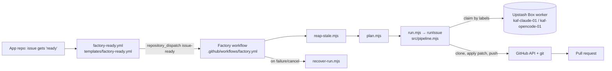

# 01 — Current System Audit

Scope: repository `MOT1209/kingagent-factory` at `origin/main` (commit `7aa2d22`), audited on 2026-11-19.
Rules followed: no secret values appear here; nothing was deployed; no application behaviour was changed.
Every claim carries a file reference or run/test evidence. "Implemented" means code **and** a test or a real run exists.

## 1. What the system is today

A **GitHub-issue-to-pull-request factory**. A person labels an issue `ready` in an app repo; a GitHub Actions workflow in this repo claims a worker (an Upstash Box), runs a coding agent (Claude Code or OpenCode) inside it, runs the repo's checks, and opens a PR. It never merges.

It is a single-purpose pipeline of about **5,500 lines of Node.js (ESM)**, with one runtime dependency (`@upstash/box`, `package.json`). There is no server, database, API, UI or persistent store: state lives in GitHub labels/comments and Upstash Box labels.

## 2. Evidence base

| Evidence | Result |
|---|---|
| Linux CI, `Test` workflow, run 44535152044 (push to `main`) | `ℹ tests 167`, `pass 167`, `fail 0`, 216 s |
| Local run on Windows 11, Node 24.19.0, `npm run check` | `tests 129`, `pass 106`, `fail 23`, 994 s. All 23 errors are `"setup" did not finish within 0.1 minutes` (`src/box.mjs:64`); the tests set `commandTimeoutMinutes = 0.1` (`test/pipeline.test.mjs:74-75`). The gap between 167 declared and 129 reported on Windows is **unexplained** (not investigated; see §6). |
| `scripts/check-setup.mjs --probe-writes` (real credentials, 2026-11-19) | All sections `ok`; `All good.` Secret values never printed. |
| Real end-to-end runs (Actions, real Boxes, real agents) | `44540654147` KingAgent#23 → `needs-attention` (README already ended with the requested line; correct behaviour). `44541788313` → PR (KingAgent#25). `44546315431` → PR (KingAgent#28, a real CI fix; first push failed repo CI, issue re-labelled, same PR reused, CI green on 3 OSes). `44555309657` → PR (rashid-hq-os#14). `44557859380` → PR with the **opencode** agent (KingAgent#31). `44586072896` → PR (AgentWorld#25). |

Not verified: Claude/OpenCode behaviour beyond these runs; the claim-race guarantee under real concurrency (README "Known limitations"); cost per run (no cost data is recorded).

## 3. Subsystem inventory

Status key: **I** implemented and tested, **P** partial, **M** missing.

| # | Subsystem | Files / functions | Status | Notes |
|---|---|---|---|---|
| 1 | Entry points | `src/run.mjs`, `src/plan.mjs`, `scripts/*.mjs` (18 scripts) | I | `run.mjs` loads config, builds a redactor, calls `runIssue`, writes job summary (`run.mjs:22-60`). |
| 2 | Main pipeline | `src/pipeline.mjs` `runIssue` (≈240 lines, one function) | I | Linear: validate → claim → clone → setup → agent → checks → patch → guards → push → PR → label. Monolithic; no task abstraction. |
| 3 | Config + validation | `src/config.mjs` `loadConfig` | I | Rejects placeholders, bad labels/branches/actors, duplicate repos/workers, `boxLimit` overflow (`config.mjs:9-154`). 17 tests. |
| 4 | Worker claiming | `src/box.mjs` `claimWorker`/`releaseWorker`, `src/workers.mjs` `pickWorker` | I* | Two-phase label claim (`box.mjs:215-273`). *Correctness depends on Upstash label listing being consistent — assumed, not verified (README). |
| 5 | Agent execution | `src/agents.mjs` `signIn`, `runAgent`, `scrubBox` | I | Agents are config (`factory.config.json agents.*.command/auth/jobFiles`). Two types: `claude`, `opencode`. |
| 6 | Sandbox/Box integration | `src/box.mjs` (`sh`, `runScript`, `uploadBytes`, `downloadBytes`) | I | Background script + polling; SHA-256 checked transfers (`box.mjs:289-318`). Depends on `@upstash/box ^0.8.0`. |
| 7 | GitHub integration | `src/github.mjs`, `src/git-host.mjs` | I | Retry/backoff, token scrubbing, POST never repeated (`github.mjs:78-124`); token via env header, never URL (`git-host.mjs:20-41`). 24 + 11 tests. |
| 8 | State machine | `src/issue-state.mjs` | I | `ready → running → review | needs-attention`; add-before-remove (`issue-state.mjs:6-18`). |
| 9 | Security guards | `src/guards.mjs` | I | Protected paths (`.github/`, `CODEOWNERS`, `.git`), change-size limits, lockfile-only / test-deletion refusal, secret redactor, trusted-comment filter (`guards.mjs:21-77`). |
| 10 | Retry / failover | `pipeline.mjs:219-231`, `guards.mjs:49` | I | One retry on another agent type when the provider reports a limit; one agent fix round after a failed check (`pipeline.mjs:248-255`). |
| 11 | Recovery | `src/recover.mjs`, `.github/workflows/reap.yml` | I | `recoverRun`, `reapStale`; sweep before every run and every 3 h. 13 tests. |
| 12 | Observability | `src/report.mjs`, `src/ops.mjs`, `scripts/status.mjs`, `doctor.mjs`, `report.mjs` | P | Per-run summary + one `factory-stats` log line; totals computed by parsing logs. No metrics store, no cost data, no dashboards. |
| 13 | Worker image | `worker/setup.sh`, `scripts/build-snapshot.mjs`, `factory.config.json factory.snapshotId` | I | Node 24, zsh, opencode CLI. Comments name KingAgent-specific needs, i.e. the image is coupled to current apps. |
| 14 | Setup/ops tooling | `scripts/set-secrets.mjs`, `install-trigger.mjs`, `provision-workers.mjs`, `check-setup.mjs` | I | Preview by default, `--yes` to apply; idempotent. **No per-repo filter** (`set-secrets.mjs:18`, `install-trigger.mjs:19`). |
| 15 | CI/CD | `.github/workflows/test.yml`, `factory.yml`, `reap.yml`, `claude.yml`, `claude-code-review.yml`, `dependabot.yml` | I | Actions pinned to major tags, not SHAs. |
| 16 | Tests | `test/*.test.mjs` (13 files, 167 declared), `test/local-box.mjs`, `test/helpers.mjs` | I | Unit + pipeline tests with fakes and a local Box stand-in. No test hits a real Box or GitHub; real behaviour is evidenced only by the runs above. |
| 17 | Documentation | `README.md`, `docs/stage-02…10-*.md` | P | **Stale:** README says "No end-to-end run has happened" and "Claude has not completed a run" (README "Known limitations"); both are now false (see §2 runs). |
| 18 | Multi-repo support | `factory.config.json repos[]` | I | 10 repos configured; per-repo `setup`, `checks`, `exclude`, `limits`, `secrets`. |
| 19 | Extensibility | config-driven agents/repos/workers | P | New agent/repo needs no code except the secret line in `factory.yml` (enforced by `test/workflow.test.mjs`). No plugin model, no roles, no skills, no MCP. |
| 20 | Cost management | `agentMinutes` in `report.mjs` | M | Only minutes are counted. No token counts, money, budgets or limits beyond `boxLimit` and timeouts. |

## 4. Working functionality (with evidence)

- Label → dispatch → run → PR on two agent types and three app repos (§2 runs).
- Check failure handling: run `44546315431` had a repo test fail on the first PR; re-labelling replaced the factory branch and reused the same PR (`github.mjs:148-173`; `test/pipeline.test.mjs` "retrying the same issue replaces the factory's branch and reuses the PR").
- A no-op issue is handed back with the agent's reply (run `44540654147`; `pipeline.mjs:268-270`).
- Worker release and Box pause after every job (`pipeline.mjs:299-313`; status shows both workers `free`/`paused`).
- Config rejects bad input (17 config tests).

## 5. Findings

### 5.1 Security (details in 07)
- **F-S1 (High) Agent runs unrestricted inside the Box.** Claude is started with `--dangerously-skip-permissions` (`factory.config.json agents.claude.command`); the Box user has passwordless sudo. The boundary is the Box + "no GitHub token in the Box" (`pipeline.mjs:3-6`). Prompt injection is explicitly "not solved" (README "Security notes").
- **F-S2 (Medium) One fine-grained PAT writes to every app repo.** `FACTORY_GITHUB_TOKEN` is shared by all repos and stored as a secret in each (`set-secrets.mjs`). Compromise of one workflow in any repo with that secret = write access to all. No GitHub App, no per-repo scoping, manual expiry.
- **F-S3 (Medium) Residual cross-job leakage.** A process that changes directory and detaches survives the scrub; Boxes are reused across jobs (README "Known limitations", `agents.mjs:64-74`).
- **F-S4 (Medium) Extra Claude workflows on the factory repo.** `claude.yml` and `claude-code-review.yml` (added by PR #14) use `CLAUDE_CODE_OAUTH_TOKEN` with `id-token: write` on comment/issue/PR events. This adds an attack surface to the repo that also holds `UPSTASH_BOX_API_KEY` and the GitHub token. Not exploited; not reviewed in depth.
- **F-S5 (Low) Actions pinned to tags** (`actions/checkout@v4`); Dependabot is configured but pins nothing by itself (`dependabot.yml`).
- **F-S6 (Process) A token was pasted into a chat during setup** (2026-11-19) and is now stored in the secrets. Rotation recommended; tracked in 12.

### 5.2 Correctness and design
- **F-D1 Trigger/label ordering race.** The trigger fires on the `ready` label only (`templates/factory-ready.yml`); the agent choice (`agent:<name>`) is read later by `runIssue` (`pipeline.mjs:130`). If `agent:*` is added after `ready`, it only works if added before the workflow's plan step reads the labels (~10 s). It worked in runs `44541788313`/`44557859380` by luck of ordering. Safe order: add `agent:*` first, then `ready`. (An earlier message in the setup session described the opposite order; this correction is deliberate.)
- **F-D2 Monolithic pipeline.** `runIssue` mixes policy, I/O and state; adding roles, multi-step plans or another task source means editing it.
- **F-D3 No durable run record.** Outcomes live in Actions logs and a `factory-stats` line parsed by `scripts/report.mjs`.
- **F-D4 Static worker pool.** Workers are named Boxes in config; `boxLimit` 10, 2 workers. Concurrent creation of the same Box can duplicate it (README).
- **F-D5 Admin scripts lack scoping and resilience.** `set-secrets`/`install-trigger` act on all repos at once, run sequentially, and have no retry/timeouts around `gh`; during setup `install-trigger --yes` exceeded 5 minutes on 10 repos and gh calls hit `TLS handshake timeout`.
- **F-D6 Provider coupling is shallow but real.** Failure classification is a regex (`guards.mjs:49`); the agent contract is "a shell command that writes `{summary}`".

### 5.3 Quality and operations
- **F-Q1 Windows local test run is unreliable** (23 failures from a 6-second step timeout; 38 tests unaccounted for). Linux CI is green.
- **F-Q2 Stale README claims** (see row 17).
- **F-Q3 Untracked `bash.exe.stackdump`** in the working tree root (local artefact, not committed).
- **F-Q4 `npm ci` reports audit findings**; severity not inspected.

## 6. Open items that need verification in Phase 02
1. Why Windows reports 129 tests and not 167 (run per file with a spec reporter).
2. The Upstash label-consistency assumption under concurrent runs.
3. Whether `claude.yml`/`claude-code-review.yml` can be triggered by non-collaborators on the factory repo.
4. Cost per run (no data exists).

---

## 7. Revision 2 — 2026-11-19, `main` @ `6cb7693` (supersedes the numbers in §2 and the open items in §6)

Includes merged PRs #16 (Phase 01 docs), #17 (README accuracy), #18 (admin scripts), #19 (Phase 02 fixes). Method: read every file in `src/`, `.github/workflows/`, `worker/`, `templates/`, `factory.config.json`; ran the tests locally; read CI results with `gh run view`; ran `npm audit`. No secret value was read or printed.

### 7.1 Evidence refresh
| Evidence | Result |
|---|---|
| Linux CI `Test`, run `44604013267` (push to `main`, Node 24) | `tests 181`, `pass 181`, `fail 0`, `skipped 0` |
| Local Windows 11, Node 24.19, `npm test` on `main` | `tests 181`, `pass 129`, `fail 0`, `skipped 52`. The 52 are `test/pipeline.test.mjs`, skipped by design on `win32` (they need `setsid`; `pipeline.test.mjs:23-24`). This **closes F-Q1**: the earlier "129 vs 167" gap and the 23 timeouts were this, now an explicit documented decision |
| Same suite on the pre-merge branch `phase02/factory-fixes` (local, under load) | `claim.test.mjs` "a race is usually won by someone, not lost by all" **failed once** (7/10). Passed on `main` and in CI. Its pass criterion is statistical (`claim.test.mjs:55-62`): finding **N6** |
| `npm audit --omit=dev` | **1 high**: `zod`, transitive (via `@upstash/box`), "Zod can exhaust memory while validating oversized constrained collections"; fix available, **not applied** (closes the "severity not inspected" part of F-Q4) |
| Real runs (from §2) | Unchanged; no new real run was started for this audit |

### 7.2 Phase 02 delivery check (against 10's original T02 list)
| Task | Status | Evidence |
|---|---|---|
| T02-1 README stale claims | Done | PR #17 |
| T02-2 label-order race (F-D1) | **Mitigated, not eliminated** | `factory.agentLabelSettleSeconds: 8`; the run waits and re-reads when no `agent:*` label is present (`pipeline.mjs:121-135`). A label added later than the settle time is still missed |
| T02-3 admin scripts `--only`, timeouts/retries (F-D5) | Done per merge `e110ada`, `src/admin.mjs`, `test/admin.test.mjs`; **not re-audited in depth here** | PR #18 |
| T02-4 run record | Done | `report.mjs runRecord`; artifact step in `factory.yml` |
| T02-5 Windows tests | Done as an OS decision (skip with reason) | see 7.1 |
| T02-6 security quick wins | **Partial.** Actions pinned to SHAs: done (`factory.yml`, `test.yml`, `reap.yml`). `claude.yml` gated to the allowed actor: done. `claude-code-review.yml` has **no actor gate** and `id-token: write` (default `pull_request` trigger, so forks receive no secrets by default; exposure for same-repo branches **not reviewed in depth**). Token rotation: owner action, **no evidence it happened**. `zod` advisory open | workflows |
| T02-7 per-repo/global caps (S8) | **Not delivered** — no cap keys exist in `config.mjs` | `config.mjs:66` key list |

### 7.3 New findings for the expanded scope (master prompt of 2026-11-19)
| ID | Finding | Evidence |
|---|---|---|
| N1 | **No Main Agent, no delegation, no sub-agent limit, no model selection exist.** One agent works one issue in one Box | `pipeline.mjs`; before Revision 2 no document mentioned them |
| N2 | **No PowerShell anywhere.** Worker image is Debian 12 ARM64 | `worker/setup.sh` header; grep over `src/ worker/ scripts/` |
| N3 | **Browser partially provisioned:** Box Chromium is enabled and started before the agent (`box.mjs:125-166`, `pipeline.mjs:231`; `docs/stage-04`/`stage-06` "Browser access: on"), but no automation tool (Playwright, agent-browser) is installed by the image and no run evidences a browser step | `worker/setup.sh`; grep |
| N4 | **Model is the CLI default**, fixed per Box through `boxSettings` (a recorded owner choice), not per task | `factory.config.json agents.*.boxSettings`, `box.mjs:86-114` |
| N5 | `runScript` returns only the last 80 log lines; no full-log artifact | `box.mjs:58` |
| N7 | Earlier architecture documents placed Web and Desktop apps as phases 11–12; the owner has ruled them out of the current priority → **09 deferred, roadmap re-sequenced (10)** | owner instruction |
| N8 | Effective parallelism is bounded by the static pool of **2 workers** (`boxLimit` 10) | `factory.config.json workers`, `config.mjs:146` |
| N9 | No CPU/memory/process limits and no network egress policy in the repo; only wall-clock limits | grep for `ulimit`/egress: none |

### 7.4 Could not be verified (stated, not assumed)
Upstash label-list consistency under concurrent real runs; whether a Box can restrict egress; whether the pinned Claude Code/OpenCode CLIs accept a per-task model flag; PowerShell 7 and Playwright on the Debian 12 ARM64 image; Playwright-over-CDP against the managed Chromium; real cost per run (no data); the exposure of `claude-code-review.yml`; the Actions Windows-minute multiplier; behaviour of `src/admin.mjs` beyond its tests; token rotation.
