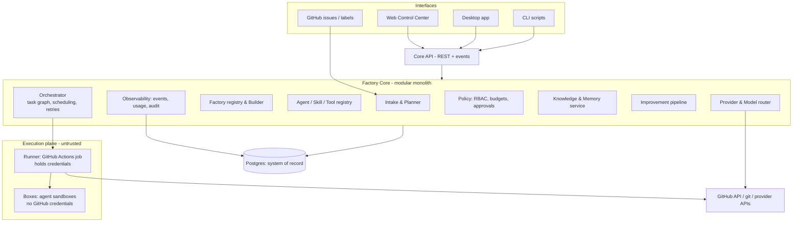

# 02 — Target System Architecture

Status: **proposal** (Phase 01). Nothing here is implemented. Builds on the verified pipeline in 01.
Principle: start with the simplest reliable design that supports growth. One deployable **Factory Core** (a modular monolith), one durable store, the existing Boxes as sandboxes. No microservices until a measured bottleneck demands one.

## 1. Design goals and constraints derived from the audit

| Constraint from the audit (01) | Consequence |
|---|---|
| The pipeline works and is tested (`pipeline.mjs`, 167 tests green on Linux) | Keep it. Wrap it as the first **executor**; do not rewrite it. |
| State only in GitHub labels/comments and Box labels (F-D3) | Add a durable store for runs, tasks, approvals, usage, memory. |
| Token never enters the Box; patch applied on the runner (`pipeline.mjs:3-6`, `git-host.mjs`) | Keep as the non-negotiable execution boundary; generalise it to every executor. |
| Agents are config (`agents.*.command`) | Generalise to a **provider adapter** (06) and **agent roles** (04). |
| One PAT for all repos (F-S2) | Move to scoped credentials (GitHub App) in the security phase. |
| Static worker pool, per-config repos | Per-factory pools and definitions (03). |

## 2. Component view

### Responsibilities and boundaries

| Component | Owns | Does NOT |
|---|---|---|
| **Intake & Planner** | Accepts requests (GitHub issue today; API later), analyses the target repo, produces a plan = list of tasks with contracts | Run code |
| **Orchestrator** | Task graph, scheduling, retries, concurrency, state transitions (generalises `issue-state.mjs`, `box.claimWorker`) | Hold provider keys or call agents directly |
| **Factory registry & Builder** | Factory definitions, templates, versions, activation (03) | Execute tasks |
| **Agent / Skill / Tool registry** | Role definitions, skills, MCP/tool manifests, validation, versions (04, 05) | Grant itself permissions |
| **Provider & Model router** | Capability-aware model choice, fallback, usage metering (06) | Decide policy |
| **Policy engine** | RBAC, per-factory permissions, budgets, approval gates (07) | Execute |
| **Knowledge & Memory** | Layered memory with isolation (see §5) | Cross-read private scopes |
| **Improvement pipeline** | Proposes changes as PRs; evaluates in isolation (08) | Merge or change security boundaries |
| **Observability** | Append-only events, usage, audit log | Mutate state |
| **Execution plane** | Runner (trusted: credentials, git, GitHub API) and Box (untrusted: agent, tests) | Let the Box hold credentials |

## 3. Communication mechanisms
- Interfaces ↔ Core: one versioned REST API (OpenAPI), plus server-sent events for live monitoring. **Web and Desktop share it** — no business logic in either client.
- Core ↔ Execution: the Core enqueues a task contract; a runner job pulls it (initially: `repository_dispatch` carrying only a task id, as `factory.yml` does today with repo+issue; the payload is **never trusted** — `pipeline.mjs:92-94` already validates it).
- Runner ↔ Box: unchanged (`box.mjs`): files API + background scripts, SHA-256 verified transfers.
- Inside Core: in-process module calls through explicit interfaces; the event log is the only cross-module write path.

## 4. Data ownership

| Data | Owner module | Store |
|---|---|---|
| Factories, versions | Registry | Postgres + config-as-code in git |
| Projects, repos, tasks, runs | Orchestrator | Postgres |
| Agent/skill/tool manifests | Registry | git (source of truth) + Postgres index |
| Usage, cost, audit | Observability | Postgres (append-only tables) |
| Secrets | Secrets manager (external) | Never in Postgres; referenced by name |
| Memory | Memory service | Postgres (+ optional vector index later) |
| Run artefacts (logs, patches) | Observability | Object storage, referenced by id |

## 5. Memory layering (summary)
Global factory → specialised factory → project → agent → task history → technical knowledge base. Every record carries `factory_id` and (where applicable) `project_id`; reads are filtered by the caller's grants in the policy engine, enforced in the data layer (row-level), not in application code alone. Global memory stores only **distilled, project-agnostic** knowledge (e.g. tool quirks) and never raw project content.

## 6. Integration points
- GitHub (issues, PRs, labels, Actions) — existing, kept as the first intake and the review gate.
- Upstash Box — existing sandbox provider, behind a `Sandbox` interface so another provider can be added.
- Model providers — through adapters (06).
- MCP servers — registered per factory, executed **inside Boxes** only (05).

## 7. What is deliberately not in the target
- No agent-to-agent free-form messaging: agents exchange **task contracts through the orchestrator** (04).
- No autonomous merge, deploy, or release (existing rule, `README` "Security notes").
- No separate service per subsystem.
- No new language/runtime: keep Node ESM (see 11, TD-02).

## 8. Evolution path from today
1. Keep `runIssue`; add run records (Phase 02).
2. Extract a `TaskContract` and call `runIssue` as the `developer` executor (Phase 03/04).
3. Introduce the store and API; GitHub stays as intake (Phase 03).
4. Generalise `factory.config.json` into factory definitions (Phase 05).
5. Add registry, router, memory, improvement, then UIs (Phases 06–12).

## 9. Bottlenecks to watch (dependency map)
`runIssue` (single function) → blocks roles/multi-step; `factory.config.json` (single file for all repos/agents/workers) → blocks multi-factory; worker pool in config → blocks concurrency growth; no store → blocks UI, budgets, memory, improvement. These four gate nearly everything; hence their position in the roadmap (10).
