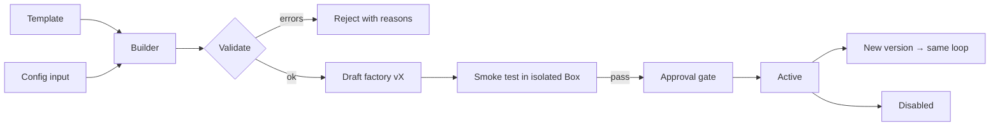

# 03 — Multi-Factory Architecture

Status: **proposal**. Today there is exactly one implicit factory: `factory.config.json` (`factory`, `agents`, `repos`, `workers`) plus one workflow. Evidence: 01 §3 rows 3, 18.

## 1. Definitions
- **Central factory** — the control plane: registry, orchestrator, policy, store. It manages factories; it does not build software itself.
- **Specialised factory** — an isolated, versioned *definition* plus its runtime resources (worker pool, secrets namespace, memory scope). Examples: Web, Game, Mobile, Desktop, AI, API, Enterprise.
- **Factory definition** — a config-as-code bundle (below), the generalisation of today's `factory.config.json`.

## 2. Factory definition (versioned, in git)
```
factories/<factory-id>/factory.json      # identity, version, limits, models, policies
factories/<factory-id>/agents/*.json     # roles (04)
factories/<factory-id>/skills/           # skill packs (05)
factories/<factory-id>/tools.json        # tool + MCP allowlist (05)
factories/<factory-id>/workers.json      # pool, image, resource limits
factories/<factory-id>/projects.json     # repos, setup, checks (today: repos[])
factories/<factory-id>/CHANGELOG.md
```
Today's keys map directly: `repos[]` → `projects.json`; `workers[]`/`factory.boxNamePrefix`/`boxLimit` → `workers.json`; `agents{}` → `agents/`; `labels` → `factory.json`. `loadConfig` validation (`src/config.mjs`) is reused per definition, so existing rules (no placeholders, no duplicate workers, label limits) carry over.

## 3. Isolation model (default deny)

| Resource | Isolation mechanism | Basis in today's code |
|---|---|---|
| Compute | Separate Box pool per factory: distinct `boxNamePrefix` and `boxLabel` | `config.factory.boxNamePrefix/boxLabel`; `workers.mjs` lists by label |
| Secrets | Per-factory secret namespace; a job receives only its factory's secrets, by name | `factory.yml` already passes secrets by name; `test/workflow.test.mjs` enforces |
| Repos | A factory may touch only repos in its `projects.json` | `findRepo` allowlist (`pipeline.mjs:74-75`) |
| GitHub credentials | One credential per factory (GitHub App installation scoped to its repos) | Today a single PAT (F-S2) — must change |
| Data | `factory_id` on every row; row-level policy | New (store) |
| Tools/MCP | Per-factory allowlist; no inheritance from other factories | New |
| Images | Per-factory worker image (today one image coupled to KingAgent, `worker/setup.sh`) | `snapshotId` already per agent type |

Sharing requires an explicit **grant** object (`from_factory`, `to_factory`, `resource`, `scope`, `expires`) created by an administrator and audited. No implicit sharing.

## 4. Factory Builder



Responsibilities, each with an acceptance check:
1. **Create from template** — templates are directories under `factory-templates/`; creating copies and fills placeholders (precedent: `install-trigger.mjs` fills `templates/factory-ready.yml`).
2. **Configure capabilities** — agents, skills, tools, models, limits.
3. **Validate** — reuse `loadConfig` rules + new rules (no tool outside the global allowlist, limits ≤ platform caps).
4. **Smoke test** — extend `scripts/smoke-test.mjs` (proves an agent type works in a Box) to run per factory before activation.
5. **Activate / disable / update / export / import / clone** — clone copies definitions but **never secrets or memory**; import re-validates everything (imports are untrusted, see 05).
6. **Resource limits** — per-factory caps on concurrent Boxes, agent minutes/day, spend/day (06), enforced by the policy engine.

## 5. Lifecycle

`draft → validated → smoke-tested → approved → active ⇄ disabled → archived`. Version bump on any definition change; running tasks finish on the version they started with. Rollback = re-activate the previous version (definitions are in git).

## 6. Communication between factories
Factories never call each other directly. The central orchestrator may hand a task from one factory to another **as a new task contract** (e.g. Web factory requests an API factory task), subject to a grant. The receiving factory sees only the contract, not the sender's memory or repos.

## 7. Versioning
SemVer on definitions; the Core records `factory_version` on every run (analogue of today's `factory-stats` record, `report.mjs`). Skill and agent versions are pinned inside the definition.

## 8. Mapping today → first specialised factory
Today's configuration becomes `factories/default` (or `web`) with no behaviour change. This is the Phase 07 starting point and the regression oracle: **the existing 167 tests and the real-run scenarios must pass unchanged against `factories/default`.**

## 9. Risks specific to this design
Cross-factory leakage (R-12), per-factory image sprawl and cost, and PAT-to-App migration blocking isolation (see 12).
