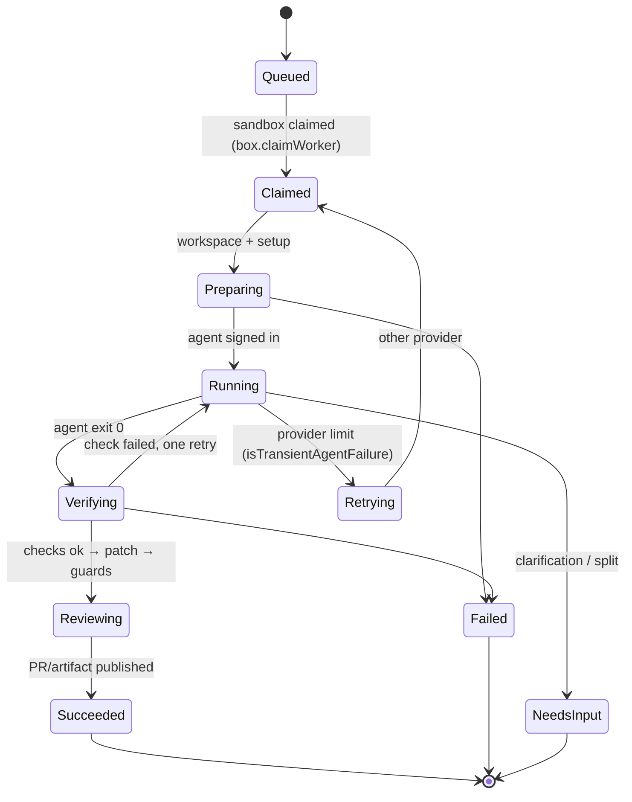

# 04 — Multi-Agent Architecture

Status: **proposal**. Today "agent" = a shell command in a Box (`factory.config.json agents.claude.command`, `agents.opencode.command`), selected by an `agent:<name>` label or priority (`workers.mjs:37-53`). There are no roles, no inter-agent contracts, no supervision beyond timeouts. Evidence: 01 §3 rows 5, 19.

## 1. Model
An **agent** = (role definition) × (provider adapter) × (skills) × (tool grants) × (limits). A **task** is executed by exactly one agent instance in one sandbox. Agents never talk to each other; the orchestrator passes **task contracts**.

## 2. Roles (initial catalogue)
Architect, Project Manager, Requirements Analyst, Developer (generic), Frontend, Backend, Mobile, Desktop, Game, AI Engineer, Database, QA, Security, Code Reviewer, DevOps, Documentation, Research.
Phase 04 implements only **Developer** (= today's behaviour), then **QA/Reviewer**; the rest are definitions added as demand appears. A role is data, not code: a manifest (below).

### Role manifest
```json
{
  "id": "developer", "version": "1.0.0",
  "responsibilities": ["implement the issue with the smallest reviewable change"],
  "input_contract": "task.v1", "output_contract": "patch-result.v1",
  "provider": {"requires": ["code-edit", "long-context"], "prefer": ["claude", "opencode"]},
  "skills": ["repo-conventions@1.2"],
  "tools": {"allow": ["shell", "git-readonly"], "deny": ["network-egress-unlisted"]},
  "limits": {"minutes": 30, "max_files": 100, "max_changed_lines": 5000},
  "memory": {"read": ["project", "task-history"], "write": ["task-history"]},
  "validation": ["repo.checks pass", "reviewChange ok"]
}
```
The limits mirror values that already exist: `agentTimeoutMinutes`, `limits.maxFiles/maxChangedLines` (`guards.mjs:56`).

## 3. Task contract (the only way agents are coordinated)
`task.v1` (immutable once issued):
```
task_id, parent_id?, factory_id, factory_version, project_id, role, role_version,
goal (untrusted text), context_refs[] (ids, not content), constraints{paths_allowed, limits, deadline},
inputs{base_sha, branch}, expected_output{type: patch|report|review, schema},
acceptance[] (commands), budget{minutes, usd}, idempotency_key
```
`result.v1`: `status (ok|needs_input|failed|refused)`, `artifacts[]`, `summary`, `usage{minutes, tokens?}`, `evidence[]`. Today's markers `NEEDS_CLARIFICATION:` / `NEEDS_SPLIT:` (`pipeline.mjs:16-17`, parsed at `235-243`) become `needs_input` with a typed reason.
`goal` is **untrusted** content; the prompt builder keeps the rule block above it (existing pattern: `buildPrompt`, `pipeline.mjs:21-50`).

## 4. Lifecycle


This is a formalisation of the verified `runIssue` flow (`pipeline.mjs:135-295`), not new behaviour.

## 5. Coordination
- **Planner** turns a request into a DAG of tasks with declared dependencies; the orchestrator schedules by dependency and by per-factory concurrency limits.
- **Supervision**: a task has a deadline (existing: `runScript` timeout, `box.mjs:50-64`) and a heartbeat (existing: `onTick`); a missed deadline kills the process group (`stopGroup`) and routes to recovery (`recover.mjs`).
- **Failure handling**: classify (provider / task / infrastructure). Provider → fail over once (exists: `pipeline.mjs:224-228`). Task → one fix round (exists: `248-255`). Infrastructure → recover and re-queue with backoff (partly exists: `reapStale`).
- **Parallel agents on one repo** require branch-per-task and a merge-conflict policy; not in scope until Phase 04 acceptance.

## 6. Execution environment
Always a Box, never the runner or a developer's machine. Credentials stay on the runner (`git-host.mjs`); the Box gets only the agent's own sign-in, removed after the agent ends (`agents.mjs:78-81`) and the whole work dir scrubbed and verified (`agents.mjs:87-97`). Moving to **fresh Box per task** (snapshot restore) closes the documented residual risk (README "Known limitations"); see TD-07.

## 7. Permissions
Least privilege per role: tool allow-list, path allow-list (generalises `protectedPaths`, `guards.mjs:21`), network egress policy where the sandbox supports it (unverified for Upstash Box), no secrets except those named by the project (`repos[].secrets`, `agents.mjs:123-133`).

## 8. Evaluation and versioning
Each run emits `usage` and `outcome` (today's `factory-stats`, `report.mjs`). Agent quality metrics: PR-opened rate, check-pass-first-try rate, human-edit rate after PR, minutes per accepted change. Role/agent manifests are versioned in git; a run records the exact versions used. Comparing versions on replayed tasks is covered in 08.

## 9. Anti-patterns avoided
Agents messaging each other; shared mutable memory between roles; an agent choosing its own tools or permissions; an agent writing to the control plane.

## 10. Main Agent, sub-agent limit and model authority (added 2026-11-19)
- The **Main Agent** is the only supervising role. It proposes decomposition, roles and model tiers; the deterministic policy engine validates and enforces (13 §1).
- **At most 4 sub-agents are active per parent task, enforced by the orchestrator** (atomic slot acquisition, leases, capability tokens). Sub-agents cannot create agents, delegate, or alter policy. Formal definition, mechanism and tests: **14**. This supersedes §5's "agents exchange contracts through the orchestrator" only by adding the limit; the contract model is unchanged.
- **Only the Main Agent (or an authorised human override) assigns models and providers**, before execution, as recorded events: **15**. The role manifest's `provider.prefer` (§2) is therefore a *hint to the router*, not a choice the agent makes.
- Real execution tiers (terminal, PowerShell, browser) a role may be granted: **16**.
