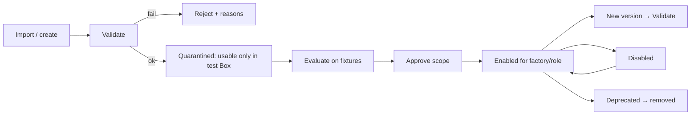

# 05 — Skills and MCP Architecture

Status: **proposal**. Today's only extension mechanism is `agents.<name>.jobFiles` (copy files from this repo into the Box at job start, `agents.mjs:135-143`; validated at `config.mjs:104-107`) and the agent CLIs' own skill/MCP features, which the factory neither manages nor audits. There is no registry, versioning, validation, or permission model for extensions. Evidence: 01 §3 row 19.

## 1. Concepts
- **Skill** — a versioned instruction pack (markdown + optional scripts/resources) loaded into an agent's context. Declarative, no authority of its own.
- **Tool** — a callable capability with a typed schema (shell, git, HTTP fetch, a custom function).
- **MCP server** — an external process exposing tools over the Model Context Protocol. Treated as a third-party tool source.
- **Extension** = skill | tool | MCP server. All share one lifecycle and one trust model.

## 2. Trust model
**No extension is trusted by default**, including ones created by an administrator and those imported from outside. Trust is granted by explicit, narrow, auditable grants:
1. *Provenance*: source, author, content hash recorded at registration.
2. *Validation*: schema check, static scan (no hidden instructions that try to override the rule block, no embedded credentials), size limits.
3. *Grants*: which factories/roles may use it, which paths, which network destinations, with expiry.
4. *Execution*: only inside a Box; never on the runner, never with GitHub credentials. (The runner is the trusted side, `pipeline.mjs:3-6`.)

Skill text enters the prompt **below** the factory rule block, mirroring how repo instructions are handled today ("as long as they do not contradict these rules", `pipeline.mjs:44`).

## 3. Lifecycle


Operations required (from the brief): create, edit, import, export, version, enable/disable, duplicate, validate, categorise, assign to agents, register MCP servers, configure connections, discover tools, validate schemas, control permissions, monitor execution, audit activity. All are Core API operations gated by RBAC (07).

## 4. Manifests
```json
// skill.json
{"id":"repo-conventions","version":"1.2.0","kind":"skill","entry":"SKILL.md",
 "sha256":"…","categories":["coding"],"requires_tools":[],"max_tokens":4000}

// mcp-server.json
{"id":"docs-search","version":"0.3.1","kind":"mcp",
 "launch":{"image":"mcp-docs@sha256:…","cmd":["serve"]},
 "network":{"allow":["docs.example.com:443"]},
 "tools":[{"name":"search","input_schema":{…},"output_schema":{…},"side_effects":"read"}],
 "secrets":[], "timeouts":{"call_s":30}}
```
Tool schemas are validated at registration **and** on every call (reject unknown tools, oversized I/O). `side_effects` ∈ {none, read, write, external}; `write`/`external` need an explicit grant and are logged with arguments (secrets redacted using the existing redactor approach, `guards.mjs:27-36`).

## 5. Where things run
| Item | Location | Reason |
|---|---|---|
| Skill content | Delivered into the Box like `jobFiles` | Existing, tested mechanism |
| MCP server | Process inside the same Box (or a sibling Box) | Keeps tool authority inside the sandbox |
| Registry, grants, audit | Core | Trusted control plane |
| Calls from Box to external MCP over network | Disabled by default; allow-listed destinations only | Untrusted egress |

## 6. Auditing and monitoring
Every tool/MCP call: `run_id, task_id, extension_id@version, tool, args_hash, size_in/out, duration, outcome`, stored append-only (02 Observability). Alerts: first use of a new version, a denied call, a call count over the per-run cap, an unexpected network destination.

## 7. Versioning and updates
SemVer; a factory pins exact versions. Updates go through Validate → Quarantine → Evaluate → Approve. Rollback = re-pin the previous version (definitions in git, 03).

## 8. Security requirements (acceptance for Phase 06)
- An imported skill containing an instruction to ignore rules does not change agent behaviour in the fixture suite (prompt-injection fixtures).
- An MCP server cannot read another factory's data or any secret not granted.
- A disabled extension cannot be called, even by a running task started earlier (checked per call).
- Every call appears in the audit log.

## 9. Compatibility with the current stack
The first increment needs no new technology: a `skills/` directory with versioned packs delivered through the existing `jobFiles` path, plus a manifest validator written like `loadConfig`. MCP is added only when a concrete tool need exists (TD-09).
