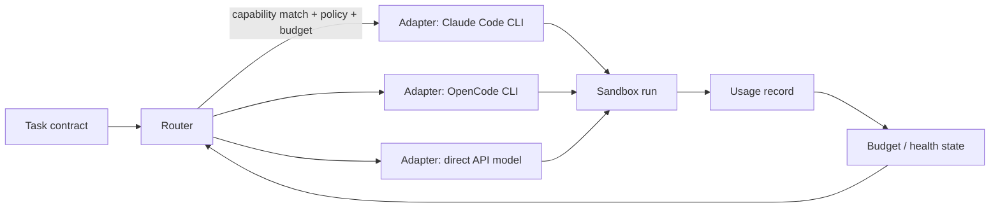

# 06 — AI Provider and Model Management Architecture

Status: **proposal**. Today: two agent types, each a CLI driven by a shell command and a secret (`factory.config.json agents.claude`, `agents.opencode`), chosen by `agent:<name>` label or `priority`, with a single failover rule when a provider reports a limit. Evidence: `workers.mjs:37-53`, `pipeline.mjs:219-231`, `guards.mjs:49`, run `44557859380` (opencode PR).

Not present: model registry, capability data, usage/token/cost tracking, budgets, provider health, rate-limit handling beyond one regex. The only usage figure recorded is `agentMinutes` (`report.mjs`).

## 1. Provider abstraction



`ProviderAdapter` interface (conceptual):
- `describe()` → provider id, supported models, **capabilities**.
- `prepare(box, task)` → sign-in material placement (today `agents.mjs signIn`, with removal after the agent ends).
- `run(box, prompt, limits)` → `{exitCode, summary, rawLog}` (today `runAgent`).
- `classifyFailure(output)` → `limit | outage | auth | task` (today the regex `isTransientAgentFailure`).
- `usage(result)` → minutes, tokens/cost when the CLI/API exposes them, else `unknown` (never invented).

Today's `agents.*` config entry **is** adapter v0; Phase 07 formalises it without breaking the config shape.

## 2. Model registry and capabilities
A model is not assumed to support everything. Registry record:
```
model_id, provider, context_window, modalities, tool_use (bool/level), code_edit (level),
structured_output (bool), latency_class, price_in/price_out (per 1M tokens, nullable),
rate_limits (nullable), data_policy (retention, region), status (active|deprecated|disabled),
evaluated_scores{task_type: score}, last_verified_at
```
Unknown values are stored as `null` and treated as "cannot satisfy that requirement" by the router, never as "supported".

## 3. Task-based routing
Inputs: role requirements (04 manifest `provider.requires/prefer`), task size estimate, factory policy, remaining budget, provider health, historical score for the task type. Output: ordered candidate list. Rules:
1. Filter by hard requirements (capabilities, data policy, factory allow-list).
2. Filter by budget and health.
3. Rank by score, then cost, then existing `priority` (preserves today's "flat-rate subscription before pay-per-token" semantics, `workers.mjs:24-27`).
4. An explicit `agent:<name>` on the task pins the provider, exactly as today (`pipeline.mjs:224` skips failover when forced).

## 4. Fallback, retries, rate limits
- Failure classes drive behaviour: `limit/outage` → fail over once to the next candidate (exists); `auth` → stop and alert (a missing/expired secret is already detected before claiming, `pipeline.mjs:167-170`); `task` → no provider change.
- Backoff with jitter for API-level limits, honouring `Retry-After` (the GitHub client already does this, `github.mjs:66-76`; reuse the pattern).
- A circuit breaker per provider: N consecutive `limit/outage` results open the circuit for a cool-off period; the router skips it.
- Total run time stays inside the run budget (existing: `runBudgetMinutes`, `secondPassMinutes`, `config.mjs:169-184`).

## 5. Usage and cost tracking
Per run: provider, model, minutes, tokens in/out (when known), estimated cost (price table × tokens; **labelled estimate**), attempts. Stored append-only. Aggregations: per factory/project/day. Today's `factory-stats` line (`report.mjs statsRecord`) is the seed schema.
Note for subscription-based CLIs (Claude via OAuth token, OpenCode free tier): tokens/cost may be unavailable; track minutes and request counts, and surface "unknown" rather than guessing.

## 6. Budgets
Configurable at platform, factory, project, and task level: max minutes, max estimated spend, max concurrent Boxes. Enforced **before** claiming a worker; on exhaustion the task is held with a typed reason and a human approval path (07). Soft alert at 80%.

## 7. Provider health
Passive: classify every result. Active (optional): a periodic tiny probe task per provider in an isolated Box (generalises `scripts/smoke-test.mjs`). Health state: `healthy | degraded | limited_until(t) | down`, visible in the dashboard.

## 8. Evaluation
Replay a fixed suite of tasks (from 08's eval harness) against candidate models in isolated Boxes; record pass rate, checks-first-try rate, minutes, cost. Scores feed routing. A model's score expires (re-evaluate on a schedule or on version change).

## 9. Avoiding lock-in
Adapters isolate vendor specifics; the task contract is provider-neutral; sign-in material and quirks (e.g. OpenCode's `auth.json` file vs Claude's env token, `factory.config.json agents.*.auth`) stay inside adapters. Cost of a new provider = one adapter + one registry record + fixtures.

## 10. Security
Provider credentials are per-factory secrets referenced by name; delivered only to the Box that runs that adapter; removed after the agent ends and verified (`agents.mjs:78-97`). Prompts and outputs are masked with the known-secret redactor before being stored or posted (`guards.mjs:27-36`). Data-policy fields prevent routing sensitive projects to providers that retain data.

## 11. Acceptance (Phase 07)
Adapter v0 reproduces today's behaviour on the existing fixtures; a third adapter can be added without changes outside `adapters/` and registry data; a forced budget exhaustion holds a task before any Box is claimed; usage records exist for 100% of runs.
