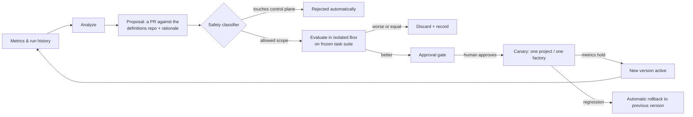

# 08 — Controlled Self-Improvement Architecture

Status: **proposal**. Nothing exists today. Precedents in the codebase that this builds on: protected paths (`guards.mjs:21`), PR-only output, human review, branch-per-run with replace-safe pushes (`git-host.mjs`), per-run stats (`report.mjs`).

Principle: **the system may propose; only a human approves; the stable configuration never changes without passing isolated evaluation and a recorded approval.** There is no unrestricted self-modification.

## 1. What may be improved (scope)
Agent instructions and role manifests, skills, workflow/pipeline parameters (timeouts, retry rules), model routing weights, test/check strategies per project, prompt templates, documentation. Explicitly **out of scope for autonomous change**: security boundaries, the policy engine, credentials handling, protected-path rules, approval logic, budget caps, this pipeline's own safety checks.

## 2. Pipeline

## 3. Performance analysis (inputs)
From the run records introduced in Phase 02: outcome, attempts, agent minutes, check-first-try pass, human edits after PR (diff between factory commit and merged result), time to merge, reasons for `needs-attention` (comment text classes), provider failures, cost estimates. Analysis is read-only and runs outside any Box.

## 4. Proposal format
A proposal is a normal pull request on the **definitions repo** containing:
- the exact diff (agent/skill/workflow parameter changes only),
- a hypothesis ("lower retry timeout reduces wasted minutes"),
- the metric(s) targeted and the evaluation result,
- the version bump and rollback instruction.
Suggestions are stored with status `suggested`; only a recorded human approval moves them to `approved`. The system distinguishes the two states everywhere (UI, API, audit).

## 5. Evaluation in isolation
- **Frozen task suite**: a versioned set of tasks (issue text + repo snapshot + acceptance checks) with known good outcomes, assembled from past runs (anonymised, per-factory; never crossing factory boundaries).
- Runs in **separate Boxes** with a separate GitHub credential limited to a sandbox org/repo; no production secrets.
- Compare candidate vs current on: success rate, checks-first-try rate, minutes, cost, refusal/guard hits. A candidate must be non-inferior on safety metrics (0 guard bypasses, 0 secret leaks in outputs on injection fixtures) and better on at least one target metric by a pre-set margin.
- Repeat runs to account for model variance; record seeds/versions.

## 6. Approval workflow
Required approver by class: *instruction/skill text* → factory admin; *routing/timeouts* → admin; *anything touching security, policy, credentials, approvals, budgets* → rejected from the automated path and handled as a normal human-authored change by an `owner`. Approval = a review on the proposal PR (GitHub review as the first implementation; Approval Center later, 07). Self-approval by the proposing agent is impossible by policy.

## 7. Versioning, rollout, rollback
- Everything is version-controlled in git; a proposal creates a new version, never edits in place.
- **Canary**: apply to one project/factory first, with automatic rollback triggers (success rate drop, guard hit, cost spike, any security alert).
- **Rollback**: re-pin previous version; a failed improvement never replaces the stable configuration (the pointer only moves after canary success).
- A **stable** pointer and a **candidate** pointer per factory; production always reads `stable`.

## 8. Security restrictions (hard rules)
1. The improver has read access to metrics and write access only to *proposal branches* in the definitions repo — no merge rights, no secrets.
2. Control-plane and security paths are on the protected list (extends `PROTECTED` in `guards.mjs:21`); a proposal touching them is auto-rejected.
3. Evaluation environments cannot reach production repos or credentials.
4. All steps are audited (07).
5. A kill switch disables the improvement pipeline per factory without affecting normal runs.

## 9. Acceptance (Phase 12)
A seeded "bad" proposal (e.g. removes a rule) is rejected by the classifier or fails evaluation; a seeded "good" proposal passes, needs approval, canaries, and can be rolled back in one step; no run can change `stable` without an approval record.

## 10. Prerequisites (why this is Phase 12, not earlier)
Run records and usage data (Phases 02–03), versioned definitions (05), evaluation fixtures and injection suite (07), the policy engine and approvals (03/07), and a frozen-task dataset — collecting real runs first is the long pole.
