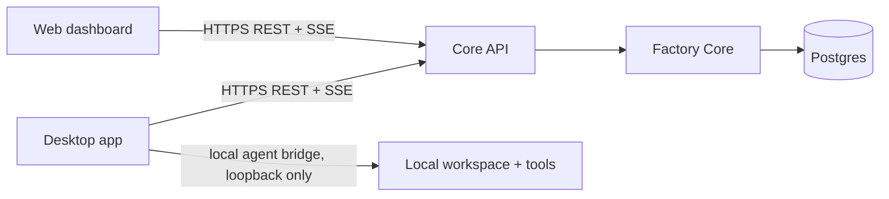

# 09 — Web and Desktop Architecture

> **DEFERRED (owner instruction, 2026-11-19).** A new Web or Desktop management application is **not part of the current priority**. This document is kept as a future-direction note only; it is not on the roadmap's critical path (10, "Deferred work"). Until reversed by the owner, interaction stays on GitHub issues/labels, Actions summaries and CLI scripts, and the Core API (13) is designed so that a UI could be added later without business logic in the client.

Status: **proposal**. Today the only "UI" is GitHub (labels, comments, PRs), the Actions run summary (`report.mjs summaryMarkdown`), and CLI scripts (`scripts/status.mjs`, `doctor.mjs`). There is no API, server or client code in this repo.

## 1. Principle: one backend, thin clients
Both interfaces are clients of the **Core API** (02). Business rules (permissions, budgets, validation, state transitions) live in the Core. A client may format, cache and optimistically update; it may never decide.

## 2. API contract
- REST, JSON, OpenAPI 3 as the single source of truth; generated typed clients for both UIs.
- Versioned (`/v1`); additive changes only within a version.
- Resources: `factories`, `projects`, `tasks`, `runs`, `agents`, `skills`, `mcp-servers`, `tools`, `providers`, `models`, `memory`, `approvals`, `budgets`, `audit`, `settings`.
- Idempotency keys on all POSTs (the existing GitHub client already treats non-idempotent POSTs as never-repeat, `github.mjs:78-86`; the same discipline applies).
- Realtime: server-sent events `/v1/events?scope=run:<id>` streaming run state, log lines (masked), usage.
- Errors: typed codes with a human message and a remediation hint, mirroring `hintFor` in `github.mjs:48-57`.

## 3. Authentication and authorization
GitHub OAuth for both clients; Desktop uses the device-code flow and keeps the refresh token in the OS keychain. Authorization is server-side RBAC (07); the UI hides what a user cannot do but the API enforces it. All admin actions pass through the audit log.

## 4. Web dashboard
Sections (from the brief) mapped to API resources: Main Dashboard, Factories, Projects, Agents, Agent Teams, Skills, MCP Servers, Tools, AI Providers, Models, Memory & Knowledge, Workflows, Tasks, Execution Monitor, Logs, Analytics, Cost Management, Approval Center, Security, Settings.

Delivery order (value first):
1. **Read-only** operations view: runs, workers (what `status.mjs`/`doctor.mjs` show), outcomes, stuck-claim advice (`ops.mjs advice`).
2. Approval Center and budgets.
3. Factory/agent/skill management (writes), each behind approvals.

Stack choice is deferred to Phase 11 (TD-11): requirement is a typed client over the OpenAPI spec, server-rendered or SPA, deployable on the existing hosting the owner already uses. No decision is made here that the current stack cannot support.

## 5. Desktop application
Purpose: things a browser cannot do safely — **local development integration**.
- Workspace management: map a project to a local checkout, with explicit per-folder permission grants.
- Local execution monitor, desktop notifications for approvals/failures.
- Local agent/tool management: run an agent against a local checkout in a **local sandbox** (container/WSL) — a separate execution target behind the same task contract; never with factory credentials.
- IDE integration: open the PR/branch/diff in the editor; deep links `kingagent://task/<id>`.
- Offline-tolerant: queue read operations; writes need the backend.

Security: loopback-only bridge for local tools; each local path access is an explicit grant stored locally and visible; auto-update signed; no secrets in logs. The owner already ships an Electron application (KingAgent repo, `electron-builder.yml`); reuse its packaging and update pipeline rather than introducing a second desktop stack (compatibility with current stack, 11 TD-12).

## 6. Shared concerns
| Concern | Decision |
|---|---|
| Types/validation | Generated from OpenAPI; one schema package shared by both clients |
| i18n | Arabic and English from the start (owner works in Arabic); RTL tested |
| Accessibility | Keyboard navigation and contrast checks in CI |
| Real-time | SSE first; WebSocket only if bidirectional need appears |
| Offline cache | Desktop only, read-only data, encrypted at rest |
| Telemetry | Opt-in, no content, no secrets |

## 7. Real-time monitoring
Run timeline fed by events emitted at the same points the pipeline already logs (claim, clone, setup, agent tick, checks, guard verdict, PR). Log lines pass through the redactor before leaving the Core (`guards.mjs:27-36`). A run page shows: state, worker, provider/model, minutes, cost estimate, checks, guard flags (`reviewChange` flags), PR link.

## 8. Acceptance
- A run started from GitHub appears in the Web dashboard within a few seconds with correct state transitions (compared against the Actions log).
- An action denied by RBAC is denied identically from Web, Desktop and raw API.
- The Desktop app and Web share one generated API client and no duplicate business logic (checked in review).
- Loss of the Desktop's network never loses a write (writes are rejected, not queued silently).

## 9. Risks
Scope creep (twenty sections at once): mitigated by the delivery order. Two clients drifting: mitigated by generated clients and contract tests. Local execution target widening the attack surface: mitigated by treating it as another untrusted sandbox with no factory credentials.
