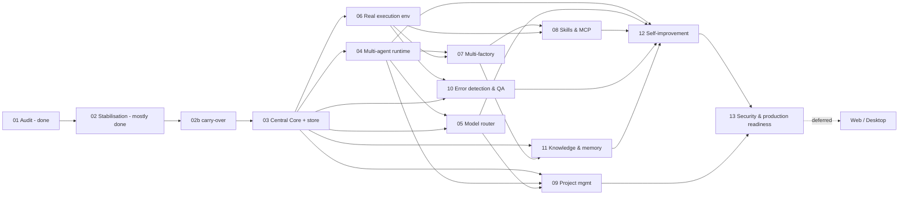

# 10 — Development Roadmap (Revision 2, 2026-11-19)

Dependency-driven, **no calendar dates**. A phase is done only when its completion conditions are verified with evidence (tests, real runs, or recorded approvals). Nothing below is started without the owner's explicit approval of the phase.

Revision 2 re-sequences the roadmap to the owner's suggested order (router and real execution before multi-factory) and **defers the Web and Desktop applications** (09, TD-15). Phase 01 and most of Phase 02 are already delivered (01 §7).

## 0. Phase map (old → new numbering; older documents were updated accordingly)
| New | Topic | Old Revision-1 number |
|---|---|---|
| 01 | Audit and architecture | 01 |
| 02 | Core stabilisation (+ carry-over **02b**) | 02 |
| 03 | Central Factory Core | 03 |
| 04 | Multi-agent runtime (Main Agent, delegation, 4-agent limit) | 04 |
| 05 | Intelligent model router and providers | 07 |
| 06 | Real execution environment (terminal, PowerShell, browser) | *new* |
| 07 | Multi-factory engine and Factory Builder | 05 |
| 08 | Skills and MCP ecosystem | 06 |
| 09 | Project management engine | 08 |
| 10 | Error detection and automated QA | *new* |
| 11 | Knowledge and memory | 09 |
| 12 | Smart improvement and controlled self-improvement | 10 |
| 13 | Security and production readiness | 13 |
| Deferred | Web control center, Desktop app | 11, 12 |

## 1. Dependency graph

Notes: 04 uses a **static tier→model table** until 05 makes routing intelligent (so the Main Agent can already "assign" within a fixed policy). 05 and 06 can overlap once 03 exists. 06's browser work is gated on a verified egress control (R-38).

## 2. Rules for every phase
- **Preserve behaviour:** the test suite stays green on Linux CI (181 tests on `main`), and the six real-run scenarios (01 §2) are replayed as dry-run regression checks.
- Each phase ends with: updated docs from verified implementation (22 §6), updated risk register (12), a security review of the new surface, and a **recorded owner approval** before the next phase.
- No deploy, publish or merge without explicit owner approval. Every change ships as a small reviewable PR and is reversible by reverting that PR (the strategy below adds phase-specific rollback).
- The existing guarantees are invariants: GitHub token never in a sandbox; the factory never merges; protected paths never pushed (`guards.mjs`).

---

## Phase 01 — Repository audit and architecture — **delivered; Revision 2 awaiting approval**
Objectives: inspect, document, plan. Deliverables: `docs/architecture/01–22` (01 §7 is the current audit). Acceptance: completion gate of the owner prompt (§26) satisfied by `00_FINAL_REPORT.md`. Rollback: documents only; revert the PR.

## Phase 02 — Core stabilisation — **mostly delivered** (01 §7.2)
Delivered: README accuracy, label-settle mitigation, admin scripts hardening, run records, Windows test decision, SHA-pinned Actions, `claude.yml` gate. **02b carry-over (open):**
- T02b-1 per-repo and global concurrency/minute caps in config, enforced before claiming a worker (R-23).
- T02b-2 gate `claude-code-review.yml` by actor (R-41); resolve `zod` advisory (TD-21, R-40).
- T02b-3 deterministic claim-race test replacing the statistical one (R-39).
- T02b-4 **owner:** rotate the exposed token and write the runbook (R-14).
- T02b-5 keep `npm audit` in CI.
Modules: `src/config.mjs`, `src/pipeline.mjs` (admission only), `test/claim.test.mjs`, `.github/workflows/claude-code-review.yml`, `package-lock.json`. New: none. Tests: config tests for caps; the new deterministic race test. Security: no new permissions. Acceptance: over-cap run refused with a clear comment; `npm audit` clean or accepted in writing; race test has no probabilistic assertion. Rollback: revert PR. Completion: CI green + owner approval.

---

## Phase 03 — Central Factory Core (13)
1. **Objectives:** durable store, task/result contracts, events, deterministic orchestrator wrapping today's pipeline, policy stub, approvals record.
2. **Tasks:** store schema (factories, projects, tasks, runs, events, usage, approvals, audit); `task.v1`/`result.v1` and schema validation; event log (22 §2); `runIssue` invoked as the `developer` executor unchanged (strangler); deterministic single-task planner; run records written to the store; full logs as artifacts (N5); policy stub (budgets/concurrency from T02b-1).
3. **Dependencies:** 02b. **Owner decision:** store hosting (TD-03).
4. **Existing modules affected:** `src/run.mjs`, `src/report.mjs`, `src/pipeline.mjs` (wrapped; stages not yet split), `src/box.mjs runScript` (full-log capture).
5. **New modules:** `core/store`, `core/events`, `core/orchestrator`, `core/policy`, schemas, migrations.
6. **Acceptance:** same issue → same outcome through old and wrapped paths on the six scenarios; every run has a store row + event chain; contracts validated; unauthenticated access denied (if an API is exposed — otherwise store credentials scoped).
7. **Tests:** contract/schema tests; replay parity; migration up/down; redaction test (no secret in events).
8. **Security:** secrets never stored (names only); append-only audit; least-privilege store credentials.
9. **Rollback:** feature flag keeps the old path; migrations reversible; revert PR.
10. **Completion:** parity report + owner approval.

## Phase 04 — Multi-agent runtime (04, 13, 14)
1. **Objectives:** Main Agent role, role registry, dynamic delegation with the **4-active-sub-agent limit enforced by the orchestrator**, supervision, second role (Reviewer/QA).
2. **Tasks:** split `runIssue` into stages (`prepare`, `execute`, `verify`, `publish`) under the existing tests; role manifests; slot ledger (atomic CAS) + leases + reaper (TD-17); capability tokens (Main vs sub); DAG validation; path locks; budget carving; integration step on the runner; static tier→model table.
3. **Dependencies:** 03.
4. **Affected:** `src/pipeline.mjs`, `src/agents.mjs`, `src/workers.mjs`, `src/recover.mjs`.
5. **New:** `core/roles`, `core/scheduler`, `core/slots`, `core/integrate`.
6. **Acceptance:** all of 14 §7 (5th spawn queued; slot freed on stop/timeout/crash; sub-agent token denied; cyclic/overlapping plans rejected; simulation never exceeds 4); Developer role reproduces today's behaviour; Reviewer cannot push.
7. **Tests:** property + simulation tests, token negative tests, two-task and four-task DAG scenarios in the local Box stand-in (`test/local-box.mjs`).
8. **Security:** role tool/path allow-lists; sub-agents hold no Core credentials; escape attempts logged as `security.event`.
9. **Rollback:** delegation behind a factory flag; default = single-task plan.
10. **Completion:** acceptance evidenced + one real two-subtask run reviewed by the owner. **Blocker:** pool of 2 workers limits real parallelism (N8) — owner decision on pool size/per-task Boxes (TD-07).

## Phase 05 — Intelligent model router and providers (06, 15)
1. **Objectives:** capability probes, provider/model registries, deterministic complexity classifier, Main-Agent-only assignment, fallback, escalation, usage/budget tracking, health.
2. **Tasks:** probe (extends `scripts/smoke-test.mjs`): CLI version, per-task model flag, usage fields; registries with `verified_at`; `classify`; render agent command from assignment; events `model.assign|change`; circuit breaker; typed provider errors replacing the regex; admin override with reason.
3. **Dependencies:** 03, 04. **First task** must resolve R-36 (can the CLIs take a per-task model?).
4. **Affected:** `src/agents.mjs`, `src/workers.mjs pickWorker`, `src/guards.mjs isTransientAgentFailure`, `scripts/smoke-test.mjs`, `factory.config.json`.
5. **New:** `core/router`, `core/providers`, registries.
6. **Acceptance:** 15 §8.
7. **Tests:** classifier fixtures; adapter conformance; sub-agent `assigned_model` write → 403; budget gates escalation; unverified model refused.
8. **Security:** credential delivery/removal unchanged (`agents.mjs:78-81`); agent cannot influence its model.
9. **Rollback:** router off → today's priority/label selection.
10. **Completion:** a real run records the assignment and the model used.

## Phase 06 — Real execution environment (16)
1. **Objectives:** real terminal hardening, PowerShell, Playwright browser testing, process/resource limits, isolation.
2. **Tasks:** capability probe (OS/shell/pwsh/browser); full-log artifacts; `ulimit`/timeout caps; `pwsh` in the Linux image; Windows verifier job (TD-19); Playwright-over-CDP spike then integration (TD-20); supervised app launch; egress allow-list **or** feature off; fresh-Box-per-task evaluation (TD-07).
3. **Dependencies:** 03 (records). **Gate:** egress control verified before browser tests of untrusted content.
4. **Affected:** `worker/setup.sh`, `scripts/build-snapshot.mjs`, `src/box.mjs`, `src/pipeline.mjs` (verify stage), `.github/workflows/`.
5. **New:** Windows verifier workflow, probe script, Playwright harness.
6. **Acceptance:** 16 §8.
7. **Tests:** fixture app screenshot/console/network capture in CI; resource-cap kill test; credential-read negative test; PowerShell exit-code round trip.
8. **Security:** patch-only input to verifiers, no credentials, ephemeral VMs, per-role tool grants.
9. **Rollback:** each tier is optional per factory; image rebuilt from the previous `setup.sh`; snapshot id pinned in config (revert it).
10. **Completion:** probe report + one real run with a verified browser/PowerShell step.

## Phase 07 — Multi-factory engine and Factory Builder (03)
1. **Objectives:** factory definitions, per-factory isolation, builder lifecycle (create, template, validate, activate, disable, update, export/import).
2. **Tasks:** current `factory.config.json` becomes `factories/default`; per-factory pools, secrets namespace, budgets, memory scope; templates (Web, Game, Mobile, Desktop, AI, API, Enterprise, Language); credentials per factory (GitHub App, TD-04).
3. **Dependencies:** 04, 06. **Owner decision:** App vs per-factory PAT.
4. **Affected:** `src/config.mjs`, `src/workers.mjs`, `src/box.mjs`, `scripts/set-secrets.mjs`, `scripts/install-trigger.mjs`.
5. **New:** `factories/`, `core/builder`, templates, isolation tests.
6. **Acceptance:** two factories run concurrently without crossing secrets, repos or memory; lifecycle operations work and re-validate; the default factory still passes all regression checks.
7. **Tests:** isolation **negative** suite; export/import round trip; version pinning.
8. **Security:** default-deny between factories; no shared secrets; explicit authorised grants only.
9. **Rollback:** pin the previous factory version; the default factory = today's config.
10. **Completion:** isolation suite green + owner approval.

## Phase 08 — Skills and MCP ecosystem (05)
1. **Objectives:** registry, validation, quarantine, grants, audit for skills, tools and MCP servers; all treated as untrusted.
2. **Tasks:** manifests, import/export, versioning, enable/disable, assignment to agents; MCP registration, tool discovery, schema validation, health checks, permission grants; MCP hosts run **inside Boxes** only; execution audit.
3. **Dependencies:** 06, 07.
4. **Affected:** `src/agents.mjs jobFiles`, `src/config.mjs`.
5. **New:** `core/extensions`, validators, MCP host.
6. **Acceptance:** 05 §8.
7. **Tests:** injection fixtures (malicious skill text/tool output); permission denial; audit completeness.
8. **Security:** untrusted by default; no extension can grant itself permissions; output treated as data.
9. **Rollback:** disable or pin a version; quarantine list.
10. **Completion:** fixtures green + owner approval.

## Phase 09 — Project management engine (19)
1. **Objectives:** repo analysis, requirements, planning, decomposition, dependencies, progress, blockers, reports.
2. **Tasks:** Analyst and Architect tasks; `NEEDS_SPLIT` → draft issues; epic flow with plan as PR; dependency-ordered execution (human merges); blocker detection; reports.
3. **Dependencies:** 03, 04, 05.
4. **Affected:** `src/pipeline.mjs` markers, `src/issue-state.mjs`.
5. **New:** `core/planner`, `core/projects`.
6. **Acceptance:** 19 §5. 7. **Tests:** fixture epics, invalid plans, blocker seeds. 8. **Security:** planner output is untrusted until validated; caps on plan size. 9. **Rollback:** planner off → single-issue flow. 10. **Completion:** multi-issue epic executed in dependency order in a sandbox repo.

## Phase 10 — Error detection and automated QA (17, 18)
1. **Objectives:** failure classification, diagnosis, bounded repair, verified-evidence testing, regression.
2. **Tasks:** structured step results and full logs; deterministic classifiers; diagnose role; repair tasks; stale-result rule; `testMap`; anti-fabrication report generator; quarantine policy.
3. **Dependencies:** 03, 06.
4. **Affected:** `src/pipeline.mjs` (verify), `src/guards.mjs`, `src/report.mjs`, `src/pr-body.mjs`.
5. **New:** `core/failures`, `core/verify`.
6. **Acceptance:** 17 §6 and 18 §7. 7. **Tests:** seeded-failure repos; fabrication test; replay of run `44546315431`. 8. **Security:** repairs cannot weaken checks (flags), same guards. 9. **Rollback:** repair loop off → today's single fix round. 10. **Completion:** records exist for every PR; no unquarantined flaky test.

## Phase 11 — Knowledge and memory (20)
1. **Objectives:** scoped memory with isolation, provenance, retention, backup, deletion.
2. **Tasks:** records + scopes; retrieval; prompt-injection-safe injection; retention jobs; export; deletion with tombstones; restore drill.
3. **Dependencies:** 03, 07. 4. **Affected:** `src/pipeline.mjs buildPrompt`. 5. **New:** `core/memory`.
6. **Acceptance:** 20 §7. 7. **Tests:** negative cross-scope suite; poisoning fixtures. 8. **Security:** row-level isolation; global memory holds no project content. 9. **Rollback:** memory off per factory; restore from backup. 10. **Completion:** drills pass.

## Phase 12 — Smart improvement and controlled self-improvement (08)
1. **Objectives:** analyse performance, propose improvements, evaluate in isolation, approve, roll out with rollback.
2. **Tasks:** analyses over events; proposal format; frozen task suite; isolated branch implementation; evaluation vs baseline; approval workflow; canary and rollback.
3. **Dependencies:** 04, 05, 08, 10, 11 and enough real runs for a suite.
4. **Affected:** role/skill/router configuration only — **never** security controls, policy, permissions or tests (hard rule). 5. **New:** `core/improve`.
6. **Acceptance:** 08 §9. 7. **Tests:** a proposal touching a protected area is refused; a failing evaluation never merges; rollback restores the prior version. 8. **Security:** no autonomous modification of controls; no hidden changes; no test falsification. 9. **Rollback:** version pointer re-pin. 10. **Completion:** one approved improvement evaluated, canaried and rolled back in a drill.

## Phase 13 — Security and production readiness (07)
1. **Objectives:** close or formally accept every open risk; load, soak, recovery and incident drills; cost review; runbooks.
2. **Tasks:** threat-model review per new surface; security testing (injection, escape, isolation); performance and reliability tests; backup/restore and incident drills; cost controls validated with real numbers; full integration run on all configured factories.
3. **Dependencies:** all prior phases. 4. **Affected:** whole system. 5. **New:** runbooks, drill scripts.
6. **Acceptance:** all drills pass; no open High risk in 12 without written owner acceptance. 7. **Tests:** full regression + chaos fixtures. 8. **Security:** the audit itself is repeated. 9. **Rollback:** every phase's rollback re-verified. 10. **Completion:** production-readiness report + owner sign-off.

## Deferred work
Web Control Center and Desktop application (09, TD-15). Revisit only on owner instruction; prerequisite: the Core API from Phase 03 and RBAC from 13.

## Cross-phase measurable outcomes
PR rate; first-try check pass; mean agent minutes per accepted change; incidents per 100 runs; % runs with a complete event chain; cost per accepted PR; slot utilisation (≤ 4 always); share of tasks routed to economical tiers without quality loss (22 §3).
