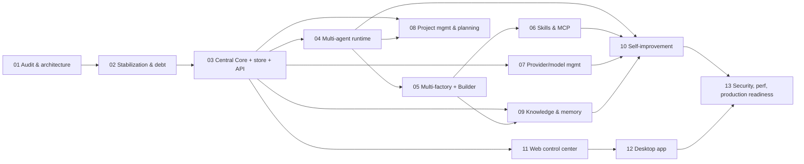

# 10 — Development Roadmap

Dependency-driven, no calendar dates. A phase is done only when its **completion conditions** are verified with evidence (tests, real runs, or recorded approvals).
The initial 13-phase proposal is kept; the audit changed the **content and order of Phase 02** and moved two security items earlier.

## 0. Dependency graph

Phases 04 and 07 can overlap after 03; 11 can start read-only as soon as 03 exposes the API.

## Global rules for every phase
- Existing behaviour preserved: the **167-test suite stays green on Linux CI** and the real-run scenarios in 01 §2 are replayed as regression checks.
- Every phase ends with: updated docs, updated risk register (12), security review of the new surface, a recorded owner approval before the next phase starts.
- No deploy/publish step without explicit owner approval.

---

## Phase 02 — Core Stabilization and Technical Debt

1. **Objectives**: close verified weaknesses without changing product behaviour; produce the data foundation for later phases.
2. **Required features / tasks** (each traceable to 01):
   - T02-1 Fix stale README claims (F-Q2) and record the real-run evidence.
   - T02-2 Remove the label-order race (F-D1): either require an `agent:*` label *before* the dispatch (trigger checks labels) or have the run re-read labels after a short settle and fail loudly if `agent:*` appears late; document the safe order.
   - T02-3 Add `--only <repo>` filters and per-call timeouts/retries to `set-secrets.mjs` and `install-trigger.mjs` (F-D5).
   - T02-4 Emit a **structured run record** (JSON) per run: id, repo, issue, outcome, worker, provider, minutes, attempts, guard flags, PR url — as an Actions artifact and as the existing `factory-stats` line (F-D3).
   - T02-5 Explain and fix the Windows test gap (129 vs 167; 23 timeouts from `commandTimeoutMinutes = 0.1`, `test/pipeline.test.mjs:74-75`) or declare Linux/WSL the supported dev OS.
   - T02-6 Security quick wins: review `claude.yml`/`claude-code-review.yml` (S4), pin Actions by SHA (S5), rotate the exposed token and write the rotation runbook (S6), `npm audit` report (F-Q4).
   - T02-7 Add per-repo and global concurrency/minute caps to config (S8) — config-only, enforced before claiming a worker.
3. **Dependencies**: Phase 01 approved.
4. **Existing modules affected**: `README.md`, `templates/factory-ready.yml`, `src/pipeline.mjs` (record emission only), `src/report.mjs`, `scripts/set-secrets.mjs`, `scripts/install-trigger.mjs`, `src/config.mjs`, `.github/workflows/*`, `test/pipeline.test.mjs`.
5. **New modules**: `src/run-record.mjs` (pure function + schema).
6. **Implementation strategy**: small PRs, one task each, produced by the factory itself where the task is well-bounded (a good dog-fooding signal), reviewed by the owner.
7. **Testing**: unit tests for every new function; workflow tests (`test/workflow.test.mjs` pattern); a replay of the six real-run scenarios in a dry-run.
8. **Security**: no new permissions; secrets handling unchanged except rotation.
9. **Acceptance criteria**: AC-02-1 README matches reality; AC-02-2 labelling in either order yields the intended agent in 20/20 trials; AC-02-3 admin scripts can target one repo and survive a simulated `gh` timeout; AC-02-4 every run has a valid record; AC-02-5 Windows `npm run check` result equals 167/167 or the OS decision is documented; AC-02-6 S4–S6 closed or accepted in writing.
10. **Completion**: all ACs evidenced; CI green; owner approval.
11. **Blockers**: Upstash/GitHub rate limits during replays; owner action for token rotation (GitHub UI).

## Phase 03 — Central Factory Core

1. **Objectives**: durable store, task contract, API, orchestrator wrapper around today's pipeline.
2. **Features**: Postgres schema (factories, projects, tasks, runs, usage, audit, approvals); `task.v1`/`result.v1`; Core API (read endpoints first); `runIssue` invoked as the `developer` executor; GitHub remains the intake.
3. **Dependencies**: 02 (run records, caps).
4. **Affected**: `src/run.mjs` (writes records to the store), `src/pipeline.mjs` (wrapped, not rewritten).
5. **New**: `core/` (api, store, orchestrator, policy stub), migrations, OpenAPI spec.
6. **Strategy**: strangler pattern; the old path keeps working behind a flag until parity is shown.
7. **Testing**: contract tests for the API; replay tests proving identical outcomes between old and wrapped paths; migration tests.
8. **Security**: authenticated API from day one; secrets never stored; audit table append-only.
9. **Acceptance**: AC-03-1 same issue → same outcome through both paths on the 6 scenarios; AC-03-2 every run has a DB row and an audit trail; AC-03-3 API denies unauthenticated calls.
10. **Completion**: parity report + owner approval. 11. **Blockers**: hosting/budget decision for Postgres (owner).

## Phase 04 — Multi-Agent Runtime
Objectives: role manifests, task DAG scheduling, supervision, second role (Reviewer/QA). Dependencies: 03. Affected: `agents.mjs`, `pipeline.mjs` (split into stages). New: role registry, scheduler. Strategy: extract stages (`prepare`, `execute`, `verify`, `publish`) from `runIssue` with unchanged tests as safety net. Testing: stage-level unit tests; a two-task DAG scenario. Security: tool/path allow-lists per role; negative tests. Acceptance: Developer role reproduces current behaviour; a Reviewer task runs read-only and cannot push; failed task retries per policy. Blockers: concurrent-claim guarantee unverified (R-06) — verify first.

## Phase 05 — Multi-Factory Engine and Factory Builder
Objectives: factory definitions, per-factory isolation, Builder lifecycle. Dependencies: 04, S2 (credential per factory). Affected: `config.mjs`, `workers.mjs`, `box.mjs`, `set-secrets.mjs`. New: `factories/`, builder, templates. Strategy: current config becomes `factories/default`; regression oracle = 167 tests + real-run replays. Testing: isolation **negative tests** (07). Security: per-factory secret namespace and credential. Acceptance: two factories run concurrently without crossing secrets/repos/memory; create/activate/disable/clone/export/import work and re-validate. Blockers: GitHub App migration.

## Phase 06 — Skills and MCP Ecosystem
Objectives: registry, validation, quarantine, grants, audit (05). Dependencies: 05. Affected: `agents.mjs jobFiles`, `config.mjs`. New: extension registry, validators, MCP host-in-Box. Testing: injection fixtures; permission tests; audit completeness. Security: untrusted-by-default. Acceptance: criteria in 05 §8. Blockers: Upstash egress control capability (unverified).

## Phase 07 — AI Provider and Model Management
Objectives: adapters, model registry, routing, usage/cost, budgets, health (06). Dependencies: 03 (store); can overlap 04. Affected: `agents.mjs`, `workers.mjs pickWorker`, `guards.mjs isTransientAgentFailure`. Testing: adapter conformance suite; budget-exhaustion hold. Security: credential delivery/removal preserved. Acceptance: criteria in 06 §11. Blockers: availability of usage data from subscription CLIs.

## Phase 08 — Project Management and Planning Engine
Objectives: intake from requirements (not only issues), repo analysis, plan → task DAG, progress, blockers, reports, archive. Dependencies: 03, 04. Testing: planning on fixture repos; blocker detection. Security: planner output is untrusted until validated against constraints. Acceptance: a multi-issue epic is decomposed, executed, and reported with correct dependency order. Blockers: quality of automatic decomposition (human review stays).

## Phase 09 — Knowledge and Memory System
Objectives: scoped memory with isolation, retention, deletion, backup. Dependencies: 03, 05. Security: row-level isolation, no raw cross-project content in global memory. Acceptance: cross-scope read attempts fail; deletion request removes data from all indices; restore drill passes.

## Phase 10 — Controlled Self-Improvement Engine
Objectives: pipeline in 08. Dependencies: 04, 06, 07, 09 and a frozen task dataset. Acceptance: criteria in 08 §9. Blockers: need enough real runs to form a suite.

## Phase 11 — Web Control Center
Objectives: dashboard per 09, read-only first. Dependencies: 03 (API), then features as their backends land. Security: RBAC enforced server-side; accessibility; AR/EN. Acceptance: criteria in 09 §8.

## Phase 12 — Desktop Application
Objectives: local workspace integration per 09. Dependencies: 11 (shared client), packaging reuse from the existing Electron app. Security: per-folder grants, loopback bridge, signed updates.

## Phase 13 — Security, Testing, Performance and Production Readiness
Objectives: close S1–S8 or accept in writing; load and soak tests; backup/restore and incident drills; cost review; operational runbooks. Acceptance: all drills pass; no open High risks in 12 without owner sign-off.

## Cross-phase measurable outcomes
Success rate of factory runs reaching a PR; checks-first-try rate; mean agent minutes per accepted change; incidents per 100 runs; % of runs with complete audit; cost per accepted PR (once measurable).
