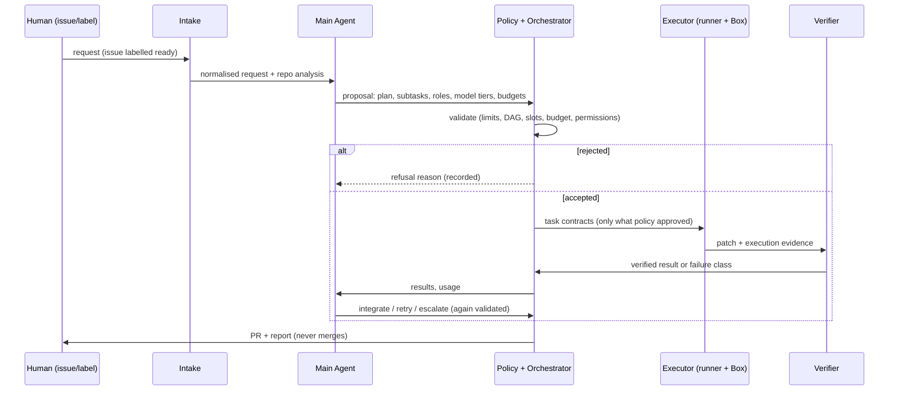

# 13 — Central Factory Core (intelligence and orchestration layer)

Status: **proposal**. Nothing in this document is implemented. Evidence for "today" columns is in 01 (Revision 2).
Scope rule from the owner (2026-11-19): interaction stays on the existing mechanisms (GitHub issues/labels, Actions, CLI scripts). **No new Web or Desktop application** (09 is deferred).

## 1. What the Core is
One deployable, deterministic **orchestration layer** plus a **Main Agent** (an LLM-assisted planning/supervising role). The split matters for authority:

| Part | Nature | Authority |
|---|---|---|
| **Policy engine + Orchestrator** | deterministic code, no LLM | **Hard authority.** Enforces limits, budgets, slots, permissions, model-assignment rights. Cannot be talked out of a rule. |
| **Main Agent** | LLM-assisted, runs as a task of its own | **Proposes** plans, decompositions, agent roles and model tiers. Its proposals take effect only after the policy engine validates them. |
| **Sub-agents** | LLM agents in sandboxes | **None** over delegation, models, providers, policies (14, 15). |

"The central system retains authority" is therefore implemented as *code that validates the Main Agent*, not as an instruction to it. A prompt is never the enforcement point.

## 2. Responsibilities: today vs. target (verified against code)

| Responsibility (prompt §5) | Today | Target module |
|---|---|---|
| Understand requests | Issue title/body passed to the agent as text (`pipeline.mjs:21 buildPrompt`) | Intake |
| Analyse repositories | None. `repos[]` holds only `setup`/`checks`/`exclude`/`limits` (`factory.config.json`) | Repo analyser (19) |
| Understand architecture | None (the agent explores on its own) | Repo analyser → project memory (20) |
| Task complexity | None | Router, deterministic scorer (15) |
| Development plan / decomposition | Only the agent's `NEEDS_SPLIT:` reply (`pipeline.mjs:259`), handed to a human | Planner (19) |
| Select agents | `agent:<name>` label, priority and busy-share (`workers.mjs:37-53`) | Orchestrator + role registry (04) |
| Assign models | **None.** CLI defaults; `boxSettings: []` is a recorded owner choice (`factory.config.json agents.claude`) | Router, Main Agent only (15) |
| Manage execution | `runIssue` + `claimWorker` | Orchestrator (wraps `runIssue`) |
| Monitor progress | `runScript` polling with `onTick` (`box.mjs:50-64`) | Orchestrator heartbeat |
| Validate results | repo `checks` + `reviewChange` (`guards.mjs:63`) | Verifier (18) |
| Detect failures / recover | exit code, `isTransientAgentFailure` regex, `recover.mjs`, `reap-stale` | Error subsystem (17) |
| Track costs | `agentMinutes` only (`report.mjs`) | Cost service (21) |
| Technical reports | Actions job summary + `runRecord` JSON artifact (`report.mjs`) | Reporting (22) |

## 3. Execution lifecycle

## 4. Invariants (platform-wide, enforced in code, each gets a test)
1. Only the orchestrator creates agent instances; only with a Main-Agent capability token (14).
2. Only the Main Agent (or an authorised human override) sets `assigned_model`; every change is an append-only event (15).
3. The GitHub token never enters a sandbox (exists today: `pipeline.mjs:3-6`, `git-host.mjs`). Generalised to every executor (16).
4. Nothing merges, deploys or publishes without a recorded human approval (exists: README "The factory never merges").
5. No security control is modifiable by an agent or by an improvement proposal (08).
6. Budgets are checked before work starts and during it; exhaustion stops work (21).
7. Results are evidence, not claims: a "passed" status needs a runner-recorded command, exit code and log hash (18).

## 5. Build order (Phase 03, dependency-aware)
1. Durable store for runs/tasks/events (nothing exists: state is GitHub labels and Box labels; 01 F-D3).
2. `task.v1`/`result.v1` types; `runIssue` invoked as the `developer` executor, unchanged (strangler).
3. Policy engine stub: budgets, concurrency, approval records.
4. Main Agent **not yet LLM-driven**: a deterministic planner that emits a single-task plan, so the pipeline's behaviour stays identical (regression oracle: 181 CI tests + the six real-run scenarios in 01).
5. Only after that, the LLM-assisted Main Agent (Phase 04+).

## 6. Hosting question (owner decision, open)
Where the Core runs is not decided. Options in 11 (TD-03, TD-08): a small always-on service, or no service at all in Phase 03 (store accessed from the Actions job). The roadmap assumes the second until a measured need appears.

## 7. Not in scope
A control UI (deferred), agent-to-agent chat, autonomous merge/deploy, self-modifying policy.
