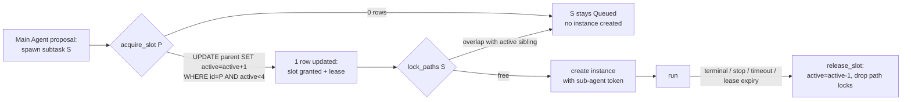

# 14 — Dynamic Agent Delegation and the Four-Sub-Agent Limit

Status: **proposal; the limit is a formal requirement (binding for Phase 04)**. Today there is no delegation at all: one agent works one issue in one Box (`pipeline.mjs`), and the nearest thing to delegation is the agent's own `NEEDS_SPLIT:` reply that a human reads (`pipeline.mjs:259`). Evidence: 01 Revision 2.

## 1. Definitions
- **Parent task P**: a task owned by the Main Agent that may be split.
- **Main Agent**: the supervising role (13). It is *not* a sub-agent and does not occupy a slot.
- **Sub-agent instance**: a running agent created by the orchestrator for a subtask of P.
- **Active** = the instance holds a slot, i.e. its state is any of `Claimed, Preparing, Running, Verifying` (04 §4). `Queued` tasks are **not** agents; no instance exists for them.
- **Slot**: the right to have one active sub-agent for P.

## 2. The requirement (formal)
> **I-1 (cap).** For every parent task P and every instant t, `active(P, t) ≤ 4`.
> **I-2 (no spawning).** A sub-agent instance can create, assign, re-assign, delegate to, or stop **no** agent, and can change no policy, model or provider. Depth of delegation is exactly 1.
> **I-3 (single authority).** Agent creation and model assignment are possible only through orchestrator operations that require a *Main-Agent capability token* bound to P.
> **I-4 (no leak).** A slot is released when its instance reaches a terminal state, is stopped, times out, or its lease expires. A crashed instance must not hold a slot forever.
> **I-5 (no duplication, no cycles).** The subtask graph of P is a DAG; no two active subtasks have the same idempotency key or overlapping write-path sets.

The limit is **enforced by the orchestration layer**, never by prompt text. A prompt that says "do not spawn more" is not a control.

## 3. Enforcement mechanism

- **Atomic acquire.** A single conditional update (compare-and-set) in the store, or an equivalent transaction with a row lock. This is deliberate: the existing worker claim uses Box labels with *no* compare-and-set and relies on an unverified assumption about label-list consistency (`box.mjs:198-203`, README "Known limitations", risk R-06). The slot ledger must not repeat that design.
- **Lease + heartbeat.** Each slot has a lease renewed by the supervisor heartbeat (today's `onTick` poll, `box.mjs:50-64`). A reaper frees expired leases — the same shape as `reapStale` (`recover.mjs:87`), which already does this for workers.
- **Capability tokens.** The orchestrator mints (a) a Main-Agent token for P with `agent.create`, `agent.assign_model`, `agent.stop`; (b) a sub-agent token with only `task.report`. The Core API denies every other call for a sub-agent token. The sub-agent's sandbox holds no credential for the Core API at all in Phase 04: results come back as files that the *runner* reads, the same boundary used today for patches (`pipeline.mjs:279-286`).
- **Delegation requests from a sub-agent** are plain data in its result (`needs_input` with a typed reason, the typed successor of `NEEDS_SPLIT`/`NEEDS_CLARIFICATION`, `pipeline.mjs:16-17`). The Main Agent may act on them; the sub-agent cannot.
- **Budget carving.** Sum of subtask budgets (`minutes`, `usd`) ≤ remaining budget of P, checked in the same transaction as the slot.

## 4. Real-world ceiling (verified, not assumed)
Four slots are a **maximum**, not a throughput promise. Parallelism is also bounded by sandboxes: `factory.config.json` defines **2 workers**, and `boxLimit` is 10 (`config.mjs:146`). With the static pool, effective parallelism is 2 until the pool grows or Boxes are created per task (TD-07). `waitForWorkerMinutes` already bounds how long a task waits for a sandbox. Parallel subtasks on one repository also require branch-per-subtask and an integration step (04 §5): the Main Agent merges subtask patches on the runner, in a defined order, and a conflict is a recorded failure, not an auto-resolution by an agent.

## 5. Delegation workflow (prompt §6.2)
1. Intake produces the request and a repo analysis (19).
2. Main Agent proposes subtasks with: role, goal, `paths_write`, dependencies, acceptance commands, budget, tier request (15).
3. Policy validates: DAG, depth = 1, budget, `paths_write` disjointness among concurrently runnable subtasks, role permissions.
4. Ready subtasks (all dependencies met) are scheduled up to the free slots; the rest stay `Queued`.
5. Supervisor monitors heartbeat, deadline, budget; on trouble the Main Agent may stop an instance (slot released) and re-plan.
6. Verifier checks each result (18); the Main Agent integrates patches on the runner; guards (`protectedPaths`, `reviewChange`, `guards.mjs`) run on the *integrated* diff, not on parts.
7. Final tests run on the integrated state; only then a PR is opened (existing behaviour, `pipeline.mjs:299-313`).

## 6. Failure and edge cases
| Case | Rule |
|---|---|
| Fifth spawn requested | Stays `Queued`; recorded; no instance; not an error. |
| Instance crashes | Lease expires, slot released, subtask marked `failed` or re-queued per retry policy. |
| Main Agent crashes | Parent is `Recovering`; orchestrator stops all instances (slots released), then recover/hand back to a human (as `recover-run.mjs` does for issues today). |
| Two subtasks touch the same file | Second waits (path lock) or the planner is told to merge them; never run concurrently. |
| Sub-agent tries to call `agent.create` | Denied, logged as a security event (07). |
| Cycle in the plan | Plan rejected at validation. |

## 7. Tests required (acceptance for Phase 04)
- Property test: N concurrent `acquire_slot` attempts never yield more than 4 grants (model on `test/claim.test.mjs`, but deterministic: no probabilistic pass criterion — see 01 Revision 2, finding on the flaky race test).
- A fifth spawn is queued and no instance exists.
- Slot released on completion, stop, timeout and simulated crash (lease expiry).
- A sub-agent token receives 403 on every Main-Agent operation.
- A cyclic plan and an overlapping-`paths_write` plan are rejected/serialised.
- Budget carving cannot exceed the parent's remaining budget.
- Invariant I-1 holds in a randomised scheduler simulation (thousands of steps).
