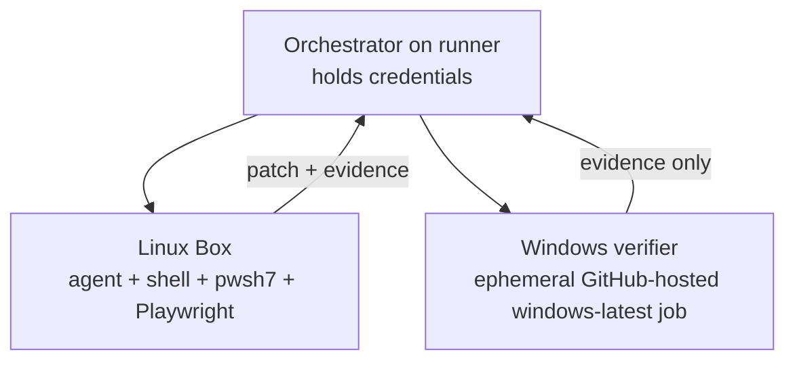

# 16 — Real Execution Environment (terminal, PowerShell, browser)

Status: terminal = **implemented**; PowerShell = **missing**; browser = **partial** (Box browser is on, no automation tooling provisioned, no recorded use). Nothing here simulates execution: every capability below runs real processes and records real exit codes and logs.

## 1. What exists today (verified)

| Capability | Evidence | State |
|---|---|---|
| Real shell in a sandbox | `box.exec.command` wrapper `sh()` and background `runScript()` with `setsid` process group, polling, timeout, group kill (`src/box.mjs:20-65`) | **I** |
| Real git/Node/package managers/test runners | Worker image: Debian 12 ARM64, Node 24, git, zsh, Claude Code, Codex, opencode (`worker/setup.sh`); repo `setup`/`checks` run in the Box (`pipeline.mjs:55-61`) | **I** |
| Stdout/stderr/exit code capture | `runScript` returns `{code, log (last 80 lines), step, minutes}` (`box.mjs:58-61`) | **I**, but log tail is only 80 lines: weak for diagnosis (17) |
| Process stop, timeouts, working dirs | `stopGroup`, `killJobProcesses`, `timeoutMinutes`, `cd workDir` (`box.mjs:47`, `agents.mjs:69`) | **I** |
| Workspace isolation | per-job dir `/workspace/home/work`, scrubbed and verified after each job (`agents.mjs:87-97`); Box reused across jobs | **P** — residual `setsid` escape (README, S3) |
| OS/shell detection | None. The image is assumed Linux | **M** |
| PowerShell (Windows PowerShell 5.1, PowerShell 7) | Not installed, not referenced anywhere in `src/`, `worker/`, `scripts/` | **M** |
| Browser | `factory.browser: true`; Box created with `browser: true`; Chromium started via `box.browser.tab.create("about:blank")` before the agent (`box.mjs:125-166`, `pipeline.mjs:231`); stage docs show "Browser access: on" (`docs/stage-04`, `stage-06`) | **P** |
| Browser automation tool inside the Box | `src/box.mjs:154-155` mentions "a tool such as agent-browser can attach on port 9222", but `worker/setup.sh` installs none, and no test or run evidences a browser step | **M / unverified** |
| Resource limits (CPU/mem/disk/process count) | Only wall-clock timeouts. No `ulimit`/cgroup configuration in the repo | **M** |
| Network restrictions | None configured; the agent has full internet (README "Security notes"). Whether Upstash Box offers egress control is **unverified** | **M** |
| Execution logs | Actions logs + last-80-lines in comments (masked by `makeRedactor`) | **P** |

## 2. Execution tiers

The **credential boundary is unchanged for every tier**: executors receive code in and send patch/evidence out; GitHub and provider credentials stay with the runner (existing design, `pipeline.mjs:3-6`).

## 3. Terminal
Keep `sh`/`runScript`. Required upgrades (Phase 06):
- Store the **full** log as an artifact (hash recorded), keep the tail for comments. Today only the last 80 lines survive.
- Add per-command resource caps (`ulimit -v/-u/-f`, `timeout`) in the generated script.
- Add an **allow-list policy** per role (14/04): the repo's `setup`/`checks` are already config-listed; ad-hoc commands the agent runs stay inside the Box sandbox, which is the boundary.
- Command audit: record `#STEP` names and exit codes (partially exists via `.step` files).

## 4. PowerShell
**Detect before assuming.** A capability probe records, per executor: `uname`/`$PSVersionTable`, `pwsh -v`, `powershell.exe -v`, OS and architecture. Upstash Boxes are Linux ARM64 (`worker/setup.sh` header) — they do **not** provide Windows PowerShell, so:
1. **PowerShell 7 on the Linux worker image** — add to `worker/setup.sh` for cross-platform scripts (Microsoft ships PowerShell 7 for Linux ARM64; installation on this exact image is **to be verified** by the image build's own `--check` step, which already fails the build when a tool is missing, `setup.sh` "Check" section).
2. **Windows verifier (recommended design):** an *ephemeral GitHub-hosted `windows-latest` job* that receives the patch + repo (tarball, SHA-256-checked like `uploadBytes`), runs build/tests in Windows PowerShell 5.1 or `pwsh` 7, and returns logs and artifacts. Reasons: no new infrastructure; fresh VM per job (stronger than reused Boxes); the same credential-free boundary. Limits: it verifies, it does not host the coding agent; costs Actions minutes (Windows is billed at a higher multiplier — verify current rates); max job time applies.
3. **Self-hosted Windows worker** only if a measured need appears (GUI/desktop apps, licensed toolchains, GPU). Must be ephemeral (VM snapshot per job), network-segmented, with no stored credentials.
The owner's own Windows machine is **not** an execution worker: it runs development and the unit tests (Windows skips the 52 `setsid`-dependent pipeline tests by design, 01 Rev. 2).

## 5. Browser automation
Findings → design:
- The Box already supports a managed Chromium reachable over CDP on `:9222` after `tab.create` (`box.mjs:154-166`). **Preferred approach: Playwright connecting over CDP** (`chromium.connectOverCDP`) so no browser binaries need to be downloaded into the image; fall back to Playwright-managed Chromium in the image if CDP attach proves unstable. Both are **unverified here** and are the first Phase 06 spike (acceptance: screenshot + console log + failed-network list of a local fixture app, from a Box, in CI).
- Playwright provides the required functions: navigation, interaction, form tests, screenshots, console messages, request/response inspection, tracing. It is a **test tool for the app under development**, not a UI for KINGAGENT FACTORY.
- Network policy: the app under test runs on `localhost` inside the Box; outbound browsing is limited to an allow-list; **if the Box cannot enforce egress rules, browser tests of untrusted content are not enabled** (security gate, 07).
- Artefacts (screenshots, traces) go to run artifacts with retention, never into the PR body un-reviewed.

## 6. Unified workflow (prompt §8.4)
Existing steps 1–3, 5, 11–12 already run: the agent edits files and runs commands in the Box, the pipeline runs `checks`, one repair round, evidence in the run record. New for Phase 06: *launch the app* (start command from the repo's declared `run` entry, supervised, port-probed), *open browser*, *e2e assertions*, *inspect logs*, *repair loop bounded by budget* (17), *report only runner-recorded evidence* (18). The final report states what was verified and by which command.

## 7. Isolation requirements (acceptance gates)
Workspace per task; permission set per role; process/time/memory limits; egress allow-list or documented "not enforceable → feature off"; secrets never in the executor except the agent's own sign-in, removed after the agent (exists, `agents.mjs:78-81`); full execution log with hash; safe termination of the whole process group (exists); **fresh sandbox per task** to close the detached-process residual (TD-07).

## 8. Acceptance (Phase 06)
Probe reports OS/shell/pwsh/browser capabilities for each executor; a PowerShell script runs in the Windows verifier and its exit code and log reach the run record; Playwright captures screenshot/console/network from a fixture app; resource caps demonstrably kill a runaway fixture; a negative test shows the executor cannot read runner credentials; regression: 181 tests and the six real-run scenarios stay green.
