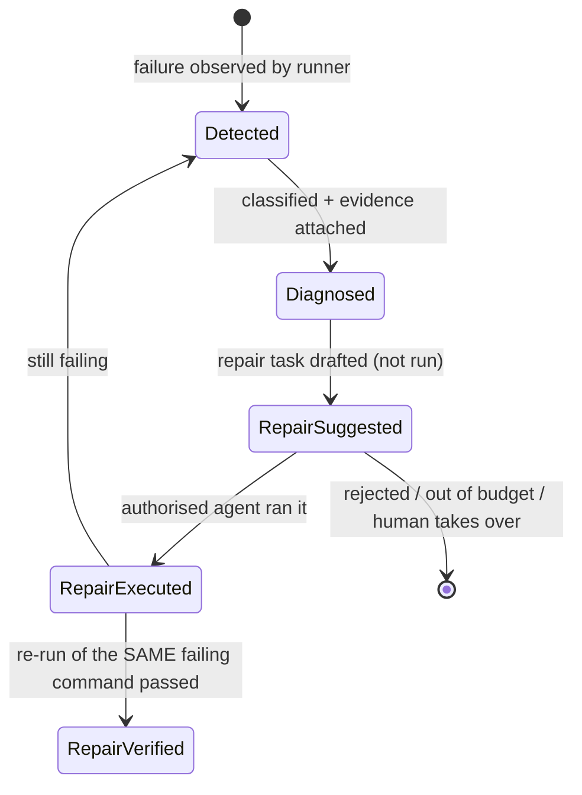

# 17 — Error Detection and Repair

Status: **partial**. One bounded repair loop exists; there is no diagnosis, classification beyond one regex, or repair-task model.

## 1. What exists (verified)
| Mechanism | Evidence |
|---|---|
| Check failure → exactly one agent fix round with the last 3000 chars of output, then re-run checks | `pipeline.mjs:264-277` ("Check failed … one chance to fix it") |
| Provider failures recognised by regex → retry once on another agent type | `guards.mjs:49 isTransientAgentFailure`, `pipeline.mjs:238-247` |
| Infrastructure failures → recovery of worker and issue | `recover.mjs` (`recoverRun`, `reapStale`), workflow step "Free the worker after an interrupted run" |
| Setup failure reported as "factory or worker image problem" | `pipeline.mjs:222-224` |
| Dangerous outcomes refused: only-lockfile, only-test-deletion, oversize, protected paths | `guards.mjs:63-77`, `protectedPaths` |
| Real evidence | Run `44546315431` (KingAgent#28): first PR failed the repo's CI, re-label replaced the factory branch and reused the PR, CI then green on 3 OSes (01 §2) |

Limits: `runScript` returns only the last 80 log lines (`box.mjs:58`), so diagnosis of long builds is blind; failures are not stored as structured data; no root-cause step; repair is "ask the same agent again".

## 2. Four distinct states (never conflated in records or reports)

A report line says exactly one of: **detected**, **suggested**, **executed**, **verified**. "Verified" requires the originally failing command to be re-run by the runner and to exit 0 (recorded command, exit code, log hash). An agent's statement that it "fixed" something is never evidence.

## 3. Detection and analysis pipeline
1. **Capture** full logs (artifact) plus structured step results `{step, command, exit, duration, log_ref}`.
2. **Classify** with deterministic parsers first: `setup | build | typecheck | lint | unit-test | integration-test | e2e | timeout | provider | infrastructure | policy-refusal`. Parsers for the stacks in `factory.config.json` (npm/TAP, `tsc`, ESLint). Unknown → `unclassified` (handled by a diagnosis task, never guessed).
3. **Localise**: files named in stack traces and failing test ids; intersect with the diff (`stagedChanges`) to separate *caused by this change* from *pre-existing/infra*. Re-run the failing check on the base commit in the Box to establish "was already failing" (recorded).
4. **Hypothesise root cause**: a Diagnose-role task (read-only, no write grant) returns `{class, suspected_files, hypothesis, confidence, evidence_refs}`; evidence refs must point at recorded log lines.
5. **Repair task** (`task.v1`, role by class: Developer for code, DevOps for build/CI, QA for flaky tests) with: failing command, log excerpt, allowed paths = suspect set ∪ diff, budget carved from the parent, attempt counter.
6. **Verify** by re-running the failing command, then the full checks (18). Regressions fail the repair.

## 4. Safety rules
- Repairs may not weaken the check: deleting/skipping tests, loosening assertions or editing check scripts to force a pass is flagged (existing guard refuses test-only deletion; extend to "assertion removed" and "check script modified" flags, surfaced in the PR like today's `flags`).
- Bounded: max attempts per task and per parent (budget-linked, 21); each attempt is a recorded event; after the bound the issue goes to `factory:needs-attention` with the diagnosis (existing state, `issue-state.mjs`).
- Infrastructure/provider failures are not "repaired" by the coding agent: they take the recovery/failover path (14/15).
- Repair work uses the same isolation, token boundary and guards as any task.
- A failed repair never leaves partial state: branch replacement uses the existing lease (`--force-with-lease`, `git-host.mjs:117`).

## 5. Data
`failure` event: `{task, step, class, command, exit, log_ref, base_also_fails, diagnosis_ref, state, attempt}`; aggregated in 22 (repeat-failure analysis feeds 08 proposals).

## 6. Acceptance (Phase 10)
Fixture repos with seeded failures of each class are classified correctly; a seeded unit-test bug reaches `RepairVerified` with recorded evidence; a seeded "agent deletes the test" attempt is flagged/refused; a provider-limit fixture is *not* sent to a coding repair; a pre-existing failure on base is reported as such; the real scenario of run `44546315431` replays as detected → executed → verified in a dry-run.
